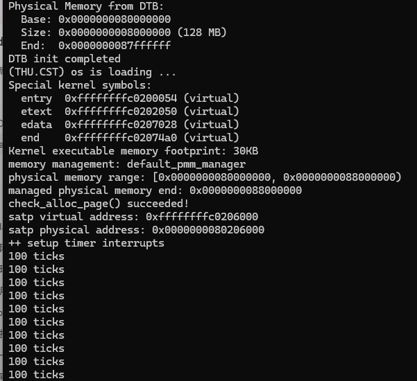
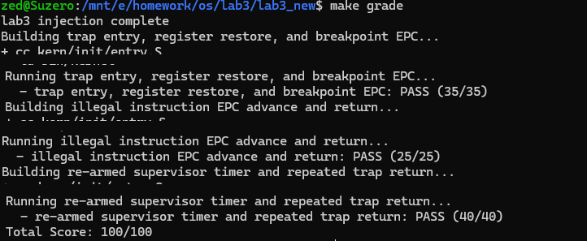
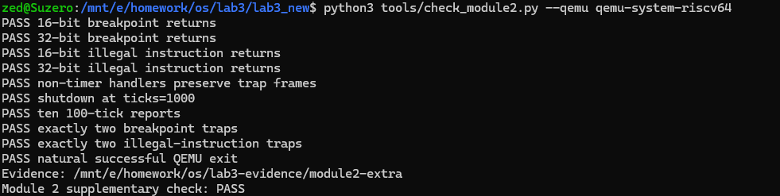

# 操作系统实验报告

## 实验基本信息

| 项目 | 内容 |
| --- | --- |
| 实验名称 | Lab3：中断与异常处理 |
| 小组成员 | 2413790-姜禧、2410250-张浩正 |
| 完成日期 | 2026-11-03 |

### 小组分工

| 成员 | 负责的练习/模块 |
| --- | --- |
| 2413790-姜禧 | 功能模块一：Trap 入口与上下文恢复；编写模块一提示词，完成本地汇编检查与集成后的运行验证。 |
| 2410250-张浩正 | 功能模块二：中断与异常处理；完成模块二提示词、环境配置、评分测试及补充测试。 |

报告按照功能模块分工整理：姜禧负责模块一的功能分析、规格设计与实现过程，张浩正负责模块二的实现说明与测试记录，共同整理整体逻辑和实验总结。

## 一、实验目的

1. 理解 RISC-V 中断与异常的处理机制，以及 Trap 进入、分发和返回的完整过程。
2. 掌握 Trap frame 的组织方式，理解汇编入口与 C 语言处理函数之间的参数传递，以及寄存器现场的保存和恢复。
3. 完成时钟中断、非法指令异常和断点异常处理，理解时钟事件的重新设置及异常返回地址的调整方法。
4. 通过编写规格和提示词辅助实现功能，并结合编译、运行和测试结果检查实现是否符合预期。

## 二、实验环境

| 成员 | AI 编程工具 | 底层模型 | 备注 |
| --- | --- | --- | --- |
| 2413790-姜禧 | VS Code、Codex | ChatGPT 6 | 辅助 Trap 入口与上下文恢复实现、代码分析及本地验证。 |
| 2410250-张浩正 | VS Code、Codex | ChatGPT 6 | 辅助中断与异常处理实现、调试及测试整理。 |

## 三、实验整体逻辑分析

### 3.1 本章节的逻辑主线

Lab1 完成了内核启动，Lab2 建立了基本物理内存管理和启动映射。本次实验在此基础上实现中断与异常处理，使内核能够在程序执行过程中响应时钟事件和指令异常，并在处理结束后恢复原执行流。

我们将实验主线理解为“保存现场、处理事件、恢复执行”。发生 Trap 时，硬件记录原因、返回地址等状态，但通用寄存器需要由软件保存。汇编入口将这些状态组织为 Trap frame，再把它交给 C 语言处理函数。处理函数根据原因完成相应操作，最后由汇编代码恢复现场并执行 `sret`。

```text
idt_init() 设置 stvec
→ clock_init() 设置首次时钟事件
→ intr_enable() 开启中断
→ 发生 Trap，硬件记录 sepc、scause 等状态
→ __alltraps 调用 SAVE_ALL 保存现场
→ trap(tf) → trap_dispatch()
→ interrupt_handler() / exception_handler()
→ __trapret → RESTORE_ALL → sret
→ 恢复执行
```

### 3.2 功能的逐步实现

1. 首先补齐 Lab2 依赖，包括物理内存初始化和 Best-Fit 分配器相关代码，使实验三具备完整的内存管理基础。迁移 `page_init()` 时，同步补充其使用的物理内存边界宏。
2. 接着实现模块一，完成 `RESTORE_ALL` 和 `__alltraps`。只有建立正确的现场保存、参数传递和恢复流程，C 语言处理函数才能与原执行流衔接。
3. 然后实现模块二，根据 Trap 原因处理中断和异常。时钟中断需要重新预约事件，断点和非法指令异常需要调整返回位置。
4. 最后进行普通运行、原评分和补充测试，验证单次异常返回、连续时钟中断以及定时关机行为。

## 四、实验内容与实现

### 功能模块一：Trap 入口与上下文恢复

**负责人：** 2413790-姜禧。

#### 模块功能描述

实现文件为 [trapentry.S](../code/kern/trap/trapentry.S)。本模块需要完成一个汇编宏和一个入口标签：

```asm
.macro RESTORE_ALL
    # 恢复 Trap frame 中的处理器状态
.endm

__alltraps:
    # 保存现场并调用 C 语言 Trap 处理函数
```

`__alltraps` 是统一的 Trap 入口。框架已在入口调用 `SAVE_ALL`，因此补写的部分只需将当前 `sp` 放入参数寄存器 `a0`，再调用 `trap()`。此时 `sp` 指向保存完成的 Trap frame，C 语言处理函数可通过这一地址访问寄存器现场和异常信息。`trap()` 返回后，执行流顺序进入已有的 `__trapret`。

`RESTORE_ALL` 负责恢复现场。我们依据 `SAVE_ALL` 的实际布局确定偏移：第 32、33 个槽位分别保存 `sstatus` 和 `sepc`，第 2 个槽位保存原来的 `sp`。实现中先借助 `t0`、`t1` 恢复两个 CSR，再恢复通用寄存器；由于 `t0`、`t1` 分别对应 `x5`、`x6`，它们原来的值也会在后续恢复。

`sp` 最后恢复，因为此前的所有读取都以当前 `sp` 为 Trap frame 的寻址基址。恢复完成后，已有的 `sret` 根据 `sepc` 返回。异常处理函数可能修改 `tf->epc`，因此恢复时使用处理后的 Trap frame，使程序从调整后的地址继续执行。

#### 最终提示词

完整提示词见 [模块一提示词](prompt.md#功能模块一trap-上下文恢复与-trap-入口功能)。

我把两个功能写在同一份四段式提示词中，共享 `SAVE_ALL`、`struct pushregs` 和 `struct trapframe` 等依赖，并分别描述它们的前后置条件。`RESTORE_ALL` 的前提是 C 语言处理已结束、`sp` 指向有效现场；`__alltraps` 的前提是 CPU 已进入 Trap 入口、现场尚待软件保存。提示词重点约束恢复布局、原栈指针的特殊处理和 RISC-V 参数传递方式。

#### 实现迭代过程

本模块经过一次代码生成完成实现，没有进行多轮代码修正。

编写提示词前，我们先阅读已有保存逻辑，明确 `RESTORE_ALL` 与 `sret` 的先后关系，以及当前栈指针和保存的原栈指针之间的区别。随后在规格中补充恢复处理后的 `epc`、避免破坏尚未读取的现场等要求，再依据最终提示词生成代码。

模块一完成时，模块二的两个处理函数尚未实现，因此先对汇编文件进行单独编译：

```bash
cd /mnt/e/homework/os/lab3/lab3_new
riscv64-unknown-elf-gcc -mcmodel=medany -Ilibs -g -c kern/trap/trapentry.S -o /tmp/lab3-trapentry.o
```

命令执行后没有报错，汇编检查通过。两个模块集成后，原评分中的上下文与断点返回测试得到 35/35；补充测试也能在异常处理后继续执行。上述结果与本模块保存现场、调用处理函数和恢复返回的目标一致。

### 功能模块二：中断与异常处理

**负责人：** 2410250-张浩正。

#### 模块功能描述

实现文件为 [trap.c](../code/kern/trap/trap.c)，需要补齐以下函数：

```c
void interrupt_handler(struct trapframe *tf);
void exception_handler(struct trapframe *tf);
```

`interrupt_handler()` 清除 `cause` 的最高中断标志位后识别中断类型。对于 S 态时钟中断，先调用 `clock_set_next_event()` 设置下一次事件，再将 `ticks` 增加一次。每满 100 次调用 `print_ticks()` 输出统计信息。实验指导书要求达到 `SHUTDOWN_AFTER` 次统计输出后关机，而代码框架未提供该宏的数值，因此本实现将其设为 10，即累计 1000 次时钟中断后调用 `sbi_shutdown()`。其他已知中断输出相应类型，未知中断输出原因和完整 Trap frame，返回地址保持不变。

`exception_handler()` 处理非法指令和断点异常，分别输出 `Illegal instruction at`、`Breakpoint at` 及对应地址。对于实验使用的 16 位压缩指令和 32 位指令，读取指令首半字，根据低两位判断长度，将 `tf->epc` 增加 2 或 4。这样返回后便能跳过已处理的异常指令。其他异常调用 `print_trapframe()` 输出现场信息。

#### 最终提示词

完整提示词见 [模块二提示词及补测提示词](prompt.md#功能模块二中断与异常处理)。

规格设计分别描述时钟中断、非法指令、断点及其他类型的处理行为。其中，时钟部分强调重新设置事件、正确计数和关机条件；异常部分强调指令长度与 `epc` 更新量一致。依赖部分使用工程中已有的时钟、Trap frame 和 SBI 接口，保持两个模块之间的调用关系不变。

#### 实现迭代过程

本模块同样经过一次代码生成完成实现，没有经历多轮功能代码修正。

模块二补齐前，完整构建曾出现两个处理函数未声明的错误，原因是框架中的待实现部分仍为空。补齐处理函数并引入所需 SBI 头文件后，完整编译通过。随后普通运行和原评分测试通过，再增加针对异常长度和关机时机的补测，十项检查均通过。

环境配置过程中使用 QEMU 4.1.1 进行验证。构建 QEMU 时使用 `--disable-werror` 处理旧版本代码的编译警告，实验内核保持原有 `-Werror` 设置。

### 思考：`do { ... } while (0)` 的作用

这种写法可以把宏内的多条语句组成语法上的一条语句，使宏调用后能够正常添加分号，并避免在 `if/else` 中出现语句绑定错误。由于条件恒为 0，宏体只执行一次。

本实验的 `local_intr_save` 保存原中断状态并关闭中断，`local_intr_restore` 按保存的状态恢复。结合内存分配函数中的使用方式，我们理解了局部关中断如何保护当前处理器上的临界区，以及为什么恢复时不能直接无条件开启中断。

## 五、测试与验证

### 5.1 测试步骤

在本地 WSL Ubuntu 的实验目录中依次执行：

```bash
cd /mnt/e/homework/os/lab3/lab3_new
qemu-system-riscv64 --version
make clean
make qemu
make grade
python3 tools/check_module2.py --qemu qemu-system-riscv64
```

补充测试使用 QEMU 4.1.1。普通运行输出十次 `100 ticks` 后自行关机，退出后继续执行评分和补测。

本地运行 `make grade` 时，曾出现 `set: Illegal option -`。检查发现 `tools/grade.sh` 使用 Windows 的 CRLF 换行，Shell 将行尾回车符参与解析。将本地脚本转换为 LF 换行后重新执行评分，脚本逻辑和评分条件保持原样。

### 5.2 测试结果

| 验证项 | 实际结果 |
| --- | --- |
| 模块一单独汇编 | `trapentry.S` 编译成功，生成目标文件 |
| 普通运行 | 输出十次 `100 ticks` 后自动退出 |
| 原评分测试 | 上下文与断点返回 35/35，非法指令及兜底处理 25/25，持续时钟中断 40/40，总分 100/100 |
| 模块二补充测试 | 十项检查全部通过，最终输出 `Module 2 supplementary check: PASS` |

### 5.3 模块二补充测试的目的与方法

原评分测试验证了上下文恢复、异常返回和持续时钟中断。阅读测试代码后，我们发现还可以进一步检查两种指令长度的异常返回，以及关机是否恰好发生在预定计数处。因此，我们增加了 `tools/test_lab3_module2.c` 和 `tools/check_module2.py`，对模块二进行补充验证。

| 检查内容 | 测试方法 | 目的 |
| --- | --- | --- |
| 16 位和 32 位断点返回 | 分别执行两种长度的断点指令，返回后通过加法指令及断言检查执行是否继续 | 验证 `epc` 分别前进 2、4 字节，避免重复触发异常或跳过后续指令 |
| 16 位和 32 位非法指令返回 | 分别执行两种长度的非法编码，检查异常处理后是否到达后续指令 | 验证非法指令异常的长度判断与返回地址更新 |
| 非时钟处理的现场保持 | 构造 Trap frame，直接调用其他中断和未处理异常的处理函数，比较调用前后现场及 `ticks` | 检查这些分支是否意外修改现场或时钟计数 |
| 关机计数与输出次数 | 在 SBI 关机接口调用处断言 `ticks == 1000`，并统计日志中的 `100 ticks` 行数 | 验证当前 `SHUTDOWN_AFTER=10` 的实现恰好输出十次统计信息后关机 |
| 异常次数与正常退出 | 统计断点、非法指令各出现两次，并检查 QEMU 的退出码和超时状态 | 检查是否出现重复异常，确认关机调用使 QEMU 正常退出 |

异常返回测试通过真实指令触发 Trap，非时钟分支则通过直接调用处理函数检查其行为。测试脚本在临时工程副本中接入这些检查，保留正常工程和原评分测试。十项检查全部通过后输出 `Module 2 supplementary check: PASS`，详细日志用于核对异常次数、时钟输出和退出状态。

### 5.4 测试记录

本地补测日志保存在 `/mnt/e/homework/os/lab3-evidence/module2-extra`，包括 `qemu.log` 和 `result.json`。以下为本机测试的终端截图，分别对应普通运行、评分和补充测试。其中，评分图片由四张终端截图按执行顺序拼接而成。







## 六、实验总结与收获

### 对操作系统的理解

通过本次实验，我们将课堂中的中断与异常处理过程与具体代码对应起来，重点理解了以下知识点。

| 实验知识点 | 对应 OS 原理 | 理解与联系 |
| --- | --- | --- |
| Trap frame 与汇编恢复 | 上下文保存与恢复 | Trap frame 保存被打断执行流的寄存器状态；本次恢复后继续原执行流，而进程切换需要选择另一执行流的上下文 |
| `cause` 分类和统一入口 | 中断与异常 | 两者都经统一入口进入内核；同步异常由当前指令触发，时钟中断由异步事件触发，具体处理由软件分发 |
| `epc` 与 `sret` | 异常返回 | `epc` 决定恢复执行的位置；本次断点和非法指令处理需要跳过对应指令，时钟中断保留原返回位置 |
| 时钟重新预约与 `ticks` | 系统计时及周期事件 | 重新预约使时钟中断持续发生，计数器记录事件次数；这一机制也为后续理解时间片和调度提供基础 |
| 保存和恢复中断状态 | 临界区保护 | 进入临界区前保存状态，退出时按原状态恢复，使临界区操作与调用前的中断设置相衔接 |

课堂中讨论的进程调度和缺页处理也使我们产生了进一步的思考：时钟中断如何引发任务切换，缺页异常如何通过建立映射后重新执行原指令。这些机制与本次实验共用 Trap 处理基础，但处理目标和返回位置的选择有所不同。

### AI 协作开发的经验

编写模块一提示词时，我们最初对栈指针的含义和恢复顺序理解不够清楚。通过AI的提示，我们知道了应该去对照 `SAVE_ALL` 与 Trap frame 布局，逐步明确了当前 `sp` 用于定位现场、原来的 `sp` 保存在现场中，因此应当最后恢复。这帮助我们把提示词写的更清楚从而一次迭代就实现了代码。

AI还能帮我们快速定位一些简单但是难以发觉的问题。就像本次实验中提到的make grade时因为`tools/grade.sh`使用了Windows的换行导致代码报错，这种我们难以发现的问题AI却能快速解决，大大提高了我们做实验的效率。
