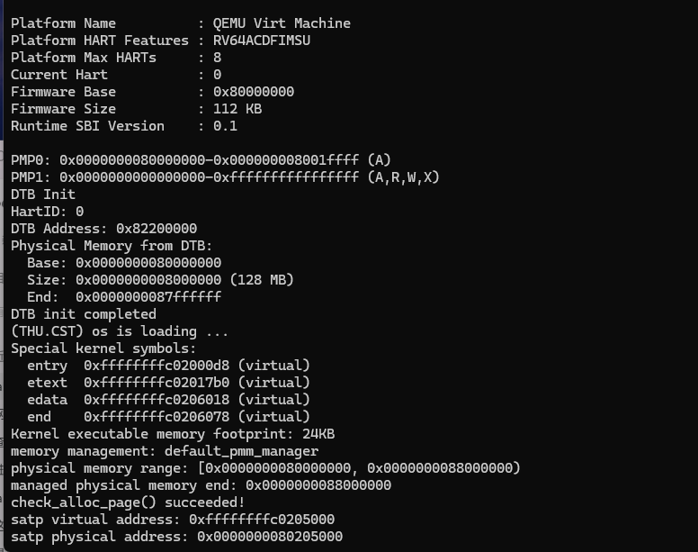
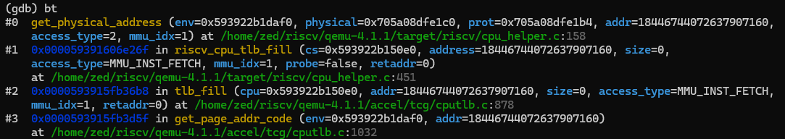
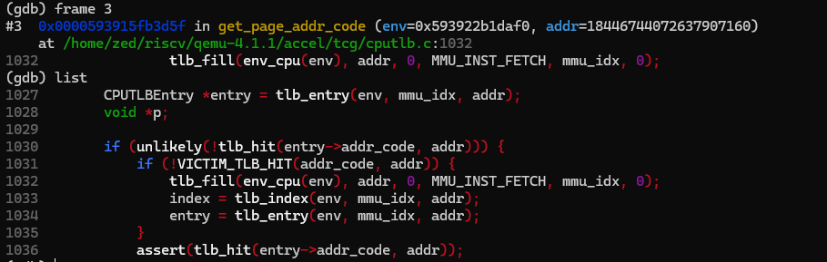
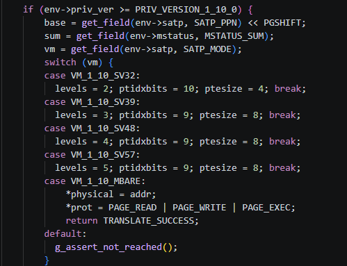
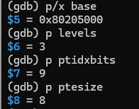
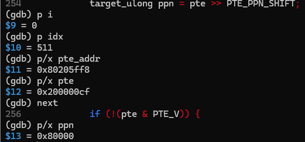
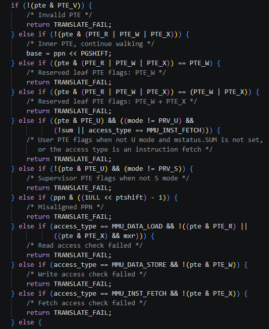
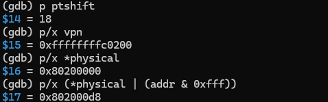
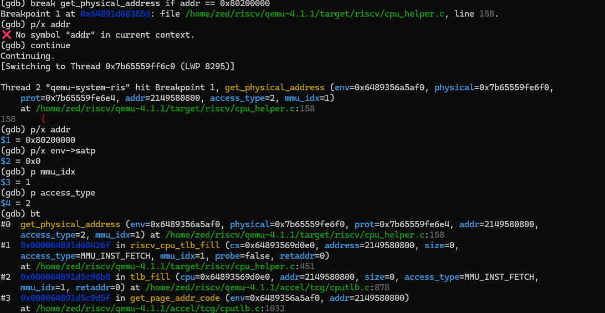
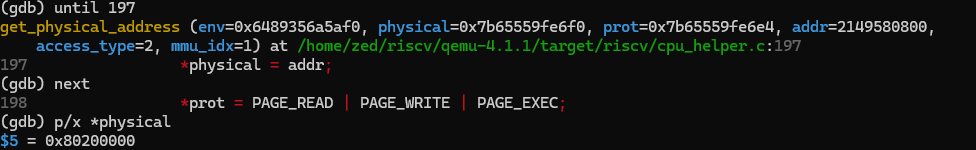

# 操作系统实验报告

## 实验基本信息

| 项目 | 内容 |
| --- | --- |
| **实验名称** | Lab2：物理内存管理 |
| **小组成员** | 2413790-姜禧、2410250-张浩正 |
| **整理日期** | 2026-10-22 |

### 小组分工

| 成员 | 负责的练习/模块 |
| --- | --- |
| 2413790-姜禧 | 功能模块一：物理内存探测与 Page 描述符初始化；分支任务：页表与 TLB 调试。 |
| 2410250-张浩正 | 功能模块二：First-Fit 原理分析、Best-Fit 实现、Buddy 实现及独立测试；运行环境适配与验证。 |

## 一、实验目的

1. 理解物理地址、虚拟地址、物理页号和 Page 描述符的区别，正确组织可用内存。
2. 理解 First-Fit，实现 Best-Fit 连续物理页分配和回收。
3. 实现 Buddy 分配器，通过独立测试验证拆分、合并、边界条件及资源恢复。

## 二、实验环境

| 成员 | AI 编程工具 | 底层模型 | 备注 |
| --- | --- | --- | --- |
| 2413790-姜禧 | VS Code、Codex | ChatGPT 6 | 物理内存初始化。 |
| 2410250-张浩正 | VS Code、Codex | ChatGPT 6 | 辅助模块二实现、调试及测试整理。 |

模块二集成验证在 WSL Ubuntu 中进行，项目目录为 `~/os/lab2/code`。使用 RISC-V 交叉编译工具链、OpenSBI 1.3 和 `gdb-multiarch`。默认启用 Best-Fit，通过 `PMM=buddy` 切换 Buddy，切换配置前清理构建产物。

## 三、实验整体逻辑分析

### 3.1 本章节的逻辑主线

Lab1 建立了最小内核的启动和输出流程；Lab2 在此基础上让内核知道哪些物理页可用，并按请求分配和回收页面。调用关系为：

```text
启动、设备树解析
  → pmm_init
  → init_pmm_manager：选择并初始化分配器
  → page_init：建立页描述符、保留已用内存
  → init_memmap：注册剩余完整空闲页
  → alloc_pages / free_pages：分配与回收
  → 管理器 check：验证功能与状态恢复
```

### 3.2 功能的逐步实现

模块一先确定可管理范围，排除 OpenSBI、内核和描述符数组占用的空间。模块二通过统一的 `pmm_manager` 接口管理这些可用页：先理解 First-Fit，再实现 Best-Fit，最后实现按幂次块组织内存的 Buddy。只有初始页面状态正确，后续分配算法的检查结果才有意义。

## 四、实验内容与实现

### 功能模块一：物理内存初始化

**负责人：** 2413790-姜禧。

#### 模块功能与实现思路

在 `kern/mm/pmm.c` 中新增 `static void page_init(void)`，不修改已有函数接口和页描述符结构。它在设备树解析、物理内存管理器初始化之后执行，负责建立物理页描述符并登记可分配页面。

本次实现按照“确定范围 → 安排描述符 → 保留已用页 → 登记空闲页”的顺序完成：

1. 调用 `get_memory_base()`、`get_memory_size()` 读取设备树解析结果，检查零值和加法溢出。将内存终点限制在 `PHYSICAL_MEMORY_END` 内，并向下按页对齐；本版页号转换以 `DRAM_BASE` 为基准，要求设备树起点与之相同。
2. 设置 `va_pa_offset=PHYSICAL_MEMORY_OFFSET`，令 `npage=PPN(maxpa)`。`npage` 是物理页号上界，不是空闲页数；`pages[0]` 描述 `DRAM_BASE` 所在物理页，因此描述符数量为 `npage-nbase`。
3. 将 `pages` 安排在内核链接符号 `end` 之后的页对齐位置，使用 `PADDR()` 得到描述符数组的物理地址。先检查数组能够完整放入可管理内存，再写入描述符，避免初始化时越界。
4. 对每个描述符清零状态，设置 Reserved、引用计数为 0、`property=0`，并初始化链表节点。这样 OpenSBI、内核和描述符自身占用的页默认不会进入空闲区。
5. 将数组结束位置向上对齐，得到 `freemem`；仅在 `freemem<maxpa` 时调用 `init_memmap(pa2page(freemem), (maxpa-freemem)/PGSIZE)`，把剩余完整页面交给当前管理器。该接口负责登记空闲块，`page_init()` 不重复实现分配算法。

关键变量分别描述不同对象：`pages` 是描述符数组的虚拟地址，`pages_pa` 是该数组的物理地址，`pa2page()` 将物理地址转换为对应描述符。没有完整空闲页时跳过登记；设备树范围无效或描述符空间不足时使用 `panic()` 停止初始化。

#### 最终提示词

提示词先给出任务与修改范围，再以 `[RELY]` 列出已有接口和结构，以 `[GUARANTEE]` 明确输出函数，以 `[SPECIFICATION]` 约束正常与异常情况。以下为实际提示词的凝练，完整整理版见 `prompt.md` 的“功能模块一”。

```text
[PROMPT]
实现 kern/mm/pmm.c 中的 static void page_init(void)，直接修改文件。
不修改已有接口、函数及头文件结构；区分虚拟地址、物理地址、物理页号和描述符地址。
[RELY]
使用已有 pmm_manager、struct Page、设备树查询函数和当前工程定义。
[GUARANTEE]
完成物理内存探测和描述符初始化，仅按需增加模块内辅助函数，不新增跨文件接口。
[SPECIFICATION]
前置：已选择并初始化物理内存管理器，读取已有的设备树解析结果。
成功：正确设置 va_pa_offset、npage、pages，输出内存范围并登记完整空闲页。
约束：处理上界和对齐，排除内核及描述符占用；无效信息终止初始化，
没有完整空闲页时不得调用 init_memmap()。
```

#### 实现与调试过程

实现前，借助 AI 核对了实际框架，确认 `KADDR()` 在当前版本中被注释，不能直接使用；`PADDR()` 依赖先设置正确的偏移；`npage` 必须按页号转换约定理解。随后据此实现 `page_init()`，未修改已有头文件接口。

首次执行 `make` 时，构建在尚未完成的 `best_fit_pmm.c` 中失败，提示 `free_list` 和 `nr_free` 未定义。分析发现 Makefile 会编译该目录所有 C 文件，即使当前选用 First-Fit，Best-Fit 测试函数仍需通过编译。为单独验证模块一，在 Best-Fit 文件的测试函数前临时补齐以下内部状态，保持 `pmm_manager` 选择 First-Fit：

```c
static free_area_t free_area;
#define free_list (free_area.free_list)
#define nr_free   (free_area.nr_free)
```

补齐内部状态后，项目编译通过，随后执行 `make qemu`，完成模块一的启动验证。此时仍使用 First-Fit，Best-Fit 的算法实现在模块二中完成。

#### 运行验证与结果

模块一单独验证在 `/mnt/e/homework/os/lab2_new` 中进行，使用当时的 QEMU 4.1.1 环境及 First-Fit 管理器。

```bash
cd /mnt/e/homework/os/lab2_new
make
make qemu
```



| 观察项 | 实际输出及含义 |
| --- | --- |
| 设备树内存 | 起点 `0x80000000`，大小 `0x08000000`，即 128 MiB |
| 可管理范围 | `[0x80000000, 0x88000000)`，上界符合框架约定 |
| 当前管理器 | `default_pmm_manager`，用于独立验证初始化结果 |
| 分配器自检 | `check_alloc_page() succeeded!`，说明初始化后的页面能够支持当前管理器的分配、回收自检 |
| 启动页表地址 | 虚拟地址 `0xffffffffc0205000`、物理地址 `0x80205000`，相差固定虚实映射偏移；输出中的 satp address 实际指根页表地址 |

设备树输出的 End 为最后一个字节 `0x87ffffff`，而本函数输出采用右端不包含的区间终点 `0x88000000`，两者一致。当前截图能够证明正常启动及 First-Fit 自检通过，集成评分另见后文记录。

### 功能模块二：物理内存分配

**负责人：** 2410250-张浩正。

#### 任务一：理解 First-Fit

[default_pmm.c](../code/kern/mm/default_pmm.c) 使用按地址组织的双向空闲链表。`default_init()` 建立空表；`default_init_memmap()` 清理页状态，将连续区域作为空闲块加入链表。块首页的 `property` 记录页数，`PG_property` 标记空闲块首页，`nr_free` 记录空闲页总数。

`default_alloc_pages(n)` 找到第一个足够大的块，取其前 n 页，把剩余部分保留为空闲块。`default_free_pages()` 将释放区按地址插入，再合并前后相邻空闲块。合并只改变块的组织方式，不额外增加空闲页数。

First-Fit 实现简单，但线性查找开销和外部碎片会随空闲块分布变化。可通过更合适的索引或搜索策略减少查找成本，同时保留相邻合并。Best-Fit 的插入过程在找到位置后结束遍历，保持空闲链表按地址有序。

#### 任务二：实现 Best-Fit

主要代码为 [best_fit_pmm.c](../code/kern/mm/best_fit_pmm.c)，通过以下函数接入管理器：

```c
static void best_fit_init(void);
static void best_fit_init_memmap(struct Page *base, size_t n);
static struct Page *best_fit_alloc_pages(size_t n);
static void best_fit_free_pages(struct Page *base, size_t n);
static size_t best_fit_nr_free_pages(void);
static void init_pmm_manager(void);  // pmm.c 中选择管理器
```

分配时遍历空闲块，选择满足请求的最小块；大小相同时保留先遇到的低地址块。成功分配恰好 n 页，余块继续挂在链表中；失败返回 NULL，状态不变。回收按地址插入并合并相邻区域，支持原测试中的部分释放和相邻已分配区一起释放。

原有 `basic_check()`、`best_fit_check()` 保持不变，默认管理器切换为 `best_fit_pmm_manager`。测试会直接清空和恢复链表、计数，因此实现不依赖测试无法同步的隐藏空闲索引。

**最终提示词概要：**

```text
[PROMPT] 补全 Best-Fit 模块并默认启用，保留原测试与模块一实现。
[RELY] 使用真实 Page、free_area_t、页状态宏和链表接口，兼容测试的状态切换。
[GUARANTEE] 实现初始化、注册、分配、释放、计数函数及管理器注册。
[SPECIFICATION] n>0；成功返回最小适配块的 n 页，失败不改变状态；
释放后合并相邻块，计数按页更新，测试完成后恢复资源。
```

完整版本见 [prompt.md 第 1 节](prompt.md#1-best-fit)。

Best-Fit 能减少单次分配的剩余空间，但仍可能产生细小碎片，也不保证未来请求的整体效果。改进方向包括按大小建立索引，并协调地址索引以便合并；本次采用便于检查的线性扫描实现。

#### 任务三：实现 Buddy 并设计独立测试

新增 [buddy_pmm.c](../code/kern/mm/buddy_pmm.c)、[buddy_pmm.h](../code/kern/mm/buddy_pmm.h) 和 [buddy_pmm_test.c](../code/kern/mm/buddy_pmm_test.c)。

```c
static void buddy_init(void);
static void buddy_init_memmap(struct Page *base, size_t n);
static struct Page *buddy_alloc_pages(size_t n);
static void buddy_free_pages(struct Page *base, size_t n);
static size_t buddy_nr_free_pages(void);
static void buddy_check(void);
void buddy_validate(void);
void buddy_run_tests(void);
```

Buddy 按阶维护空闲链表，块大小为 2 的幂，按物理页号判断对齐和伙伴关系。初始化将可用区划分为若干对齐块，保留不对齐前缀和尾部零头。申请 n 页时向上取整为 m 页，必要时逐级拆分；释放使用原始 base 和原始 n，由记录的请求信息确定实际块大小，归还整块并逐级合并同阶空闲伙伴。相邻但不互为伙伴的块不合并。

空闲页数按实际 m 页增减。例如申请 3 页会占用 4 页，释放时仍传入原始请求 3。这个约定产生内部碎片，并要求整块释放；它与 Best-Fit 的任意连续已分配区释放约定不同。`struct Page` 和模块一的初始化接口保持不变。

**算法提示词概要：**

```text
[PROMPT] 新增 Buddy 模块，通过 PMM=buddy 接入，默认保留 Best-Fit。
[RELY] 沿用 pmm_manager；可用区可能不对齐、长度可能不是 2 的幂。
[GUARANTEE] 实现管理器各函数、buddy_check 和内部状态检查接口。
[SPECIFICATION] 请求向上取整；仅接受原始 base/n 释放；
实际页数守恒，拆分不丢页，仅合并真实伙伴，失败不改变已有分配。
```

完整版本见 [prompt.md 第 2 节](prompt.md#2-buddy-system)。

**独立测试提示词概要：**

```text
[PROMPT] 为 Buddy 新增独立测试，保持 Best-Fit 原测试和评分标准。
[RELY] 采用实际舍入和释放约定，在无其他活动分配的启动阶段运行。
[GUARANTEE] 实现 buddy_run_tests，由 buddy_check 调用。
[SPECIFICATION] 断言验证大小、对齐、不重叠、拆分合并、耗尽及边界；
回收全部测试分配，恢复原可用范围和页数，再回归默认评分。
```

完整版本见 [prompt.md 第 3 节](prompt.md#3-buddy-独立测试)。

测试采用受控真实页区域检查不对齐的 13 页初始化，并验证巨大请求失败、耗尽、相邻非伙伴、占用中的伙伴及多级合并。独立的 `buddy_validate()` 检查链表、覆盖、对齐、标志和计数一致性；恢复过程实际释放和重新注册原可用区，随后再次分配验证，避免仅凭打印或重置计数认定成功。

#### 实现与调试过程

初始分支的 Best-Fit 仅有测试和占位注释，补全实现后保持两项原测试不变；随后接入 Buddy，并用独立测试验证其整块分配语义。

启动调试中，旧 loader 命令使 OpenSBI 的 Next Address 为 0；改用 `-kernel` 后到达内核入口，但开启 Sv39 时低地址执行流缺少映射。为此在启动页表中补充低地址恒等映射，保留原高地址映射，使 CPU 能继续执行并跳转到高地址内核。同步适配 QEMU、GDB 和评分脚本的启动命令，并在评分退出时回收本次 QEMU 进程。对应提示词见 [prompt.md 第 4 节](prompt.md#4-启动兼容修正)。

上述改动未修改 `page_init()` 实现、原测试断言或评分通过条件。

### 分支任务：GDB 调试页表查询过程

**负责人：** 2413790 姜禧。

#### 任务目的与调试方法

通过调试 QEMU 源码，观察一次取指访问中的 TLB 查询和页表翻译，并比较 Bare 与 Sv39 的访问路径。本部分是源码分析与调试任务，没有新增内存分配算法。

实验在 WSL Ubuntu 中使用 QEMU 4.1.1。进入 `/home/zed/riscv/qemu-4.1.1`，执行 `make distclean`，以 `--target-list=riscv32-softmmu,riscv64-softmmu --enable-debug` 重新配置并编译；不执行 `sudo make install`，仅将实验 Makefile 的 `QEMU` 指向源码目录下的调试版，保留系统原有版本。

采用三个终端：终端一执行 `make debug`；终端二用普通 GDB 附加 QEMU 进程，调试模拟器；终端三执行 `make gdb`，用 RISC-V GDB 连接内核。终端二须先 `continue`，QEMU 才能响应终端三的连接。

为减少内核单步操作，在终端三用 `p/x &kern_init` 确认入口为 `0xffffffffc02000d8`，随后在终端二提前设置条件断点：

```gdb
break get_physical_address if addr == 0xffffffffc02000d8
continue
```

再由终端三 `continue` 放行内核，在目标地址转换时暂停。`access_type=2`，调用栈也显示 `MMU_INST_FETCH`，说明本次观察的是取指访问。

#### 关键调用路径与 TLB 查询

命中断点后，通过 `bt` 得到关键调用链：

```text
get_page_addr_code()              accel/tcg/cputlb.c
  → tlb_fill()                    accel/tcg/cputlb.c
  → riscv_cpu_tlb_fill()          target/riscv/cpu_helper.c
  → get_physical_address()        target/riscv/cpu_helper.c
```



切换到 `frame 3` 后，看到取指 TLB 查询代码。`tlb_entry()` 定位待检查的条目；`!tlb_hit(entry->addr_code, addr)` 成立表示主 TLB 未命中，随后检查 victim TLB。两者均未命中才调用 `tlb_fill()`。本次已经进入它的下层转换函数，说明执行了双重未命中路径。源码在填充返回后重新获取条目，并以断言检查是否命中。

`tlb_fill()` 通过 `cc->tlb_fill(...)` 函数指针转交 RISC-V 专用处理，再进入 `get_physical_address()`。它本身是通用转接层，不包含页表遍历算法。



#### Sv39 页表翻译过程

使用 `until` 和 `next` 推进执行，用 `p/x` 查看地址与页表项；源码中的行号只用于定位，`list` 本身不执行程序。观察过程分为以下五步。

**1. 读取分页配置。** `satp=0x8000000000080205`，MODE 为 8，即 Sv39；根页表物理页号为 `0x80205`，左移 12 位得到起点 `0x80205000`。本次为 S 态访问，选择三级、每级 9 位索引、每项 8 字节的配置；不会走 M 态直接映射分支。随后检查虚拟地址高位是否合法。





**2. 定位并读取页表项。** 第一次循环提取虚拟地址位 38～30，得到 `idx=511`。页表项物理地址为 `base + idx × ptesize = 0x80205ff8`。`ldq_phys()` 从模拟物理内存读取 8 字节，得到 `pte=0x200000cf`；右移 10 位提取 `ppn=0x80000`。



**3. 判断页表项类型。** `V=0` 时转换失败；RWX 全为 0 时是非叶子项，更新 `base` 并继续查下一级。本次 `V=1`，且 R、W、X 均为 1，因此是根页表中的叶子项，映射 1 GiB 大页，第一次循环即可完成查询，并非必须走满三级。这与 `entry.S` 中最后一项的静态设置一致。

**4. 检查权限和对齐。** 函数检查非法 RWX 组合、U/S 访问权限、大页物理基址对齐，以及与读、写、取指对应的权限。本次 `U=0`，S 态取指且 `X=1`，检查通过。PTE 的 A、D 位已设置，不需要进入修改 PTE 的原子更新分支。



**5. 计算转换结果。** 函数使用以下代码组合物理页号与大页内部的页位置，并设置输出权限 `prot`：

```c
target_ulong vpn = addr >> PGSHIFT;
*physical = (ppn | (vpn & ((1L << ptshift) - 1))) << PGSHIFT;
```

实际观察到 `ptshift=18`、`vpn=0xffffffffc0200`、`*physical=0x80200000`。这里输出的是目标所在的 4 KiB 物理页起点；在 GDB 中手动加上原地址低 12 位的偏移 `0xd8`，验证完整物理地址为 `0x802000d8`。因此，函数输出的页起点与页内偏移共同确定完整物理地址。



因此，本次验证的映射为：`0xffffffffc02000d8 → 0x802000d8`。

#### Bare 对比实验与 TLB 的逻辑差异

重新启动调试，在终端二设置 `break get_physical_address if addr == 0x80200000`，捕获内核在启用分页前的入口取指。观察到 `satp=0`、`mmu_idx=1`、`access_type=2`，确认是 S 态 Bare 访问。调用栈仍经过 `get_page_addr_code → tlb_fill → riscv_cpu_tlb_fill → get_physical_address`。



执行到 Bare 分支后，单步执行 `*physical = addr`，结果为 `0x80200000`。该分支随后直接返回成功，不进入页表查询循环。



| 对比项 | Bare 实测 | Sv39 实测 |
| --- | --- | --- |
| 分页模式 | MODE=0 | MODE=8 |
| 本次输入地址 | `0x80200000` | `0xffffffffc02000d8` |
| 页表查询 | 无，直接赋值 | 读取根页表第 511 项，发现大页叶子 |
| 完整物理地址 | `0x80200000` | `0x802000d8` |
| QEMU 软件 TLB 未命中路径 | 经过 | 经过 |

两次分别选择分页开启前后的入口地址，比较实际取指经过的处理路径。实验表明，“关闭分页”不等于“QEMU 不使用软件 TLB”。真实 CPU 的分页 TLB 主要缓存虚拟页到物理页的转换和权限；QEMU 软件 TLB 还服务于客体内存到宿主机内存的快速访问，Bare 下仍需要处理模拟的物理内存访问，因此仍可能经过软件 TLB 路径。两者在加速访问上相似，但所处层次和承担的工作并不完全相同。本次对比关注两种模式下软件 TLB 未命中后的处理过程。

#### AI 辅助调试记录与收获

调试中，我将遇到的现象和变量值发给 AI 讨论，再回到源码和 GDB 中核对。以下记录几个主要问题，提问按原意作了简化。

| 实验情景与思路 | 向大模型提出的问题 | 交互后的验证与认识 |
| --- | --- | --- |
| 希望减少逐条跟踪内核指令的操作，直接定位目标访问。 | 条件断点是否更适合本次地址转换观察？ | 查询实际 `kern_init` 地址，在转换函数中按 `addr` 设置条件断点，成功捕获取指转换。 |
| Sv39 支持三级，但本次只查根页表就得到结果。 | 根页表项为何可以是叶子，不指向下一级？ | 对照启动页表和 PTE，确认最后一项是 1 GiB 大页叶子；三级是最大查询深度，遇到叶子即可结束。 |
| 需要区分查询位置、物理页号和地址结果。 | `idx`、`pte_addr`、`ppn` 分别指什么？ | 对照数值确认：索引选中页表项，`pte_addr` 定位该项，PPN 表示它指向的物理页；结合页内偏移验证完整地址。 |
| Bare 与 Sv39 都进入转换函数，需要确认执行差别。 | 为什么说 Bare 没遍历页表？Sv39 走哪个分支？ | 单步确认 Bare 执行 `*physical=addr` 后直接返回；Sv39 设置分页参数，再进入页表查询循环。 |
| 终端三连接超时，无法继续运行内核。 | 是否需要先在终端二恢复 QEMU？ | 先恢复宿主 QEMU，再重新连接内核 GDB；认识到暂停模拟器也会阻塞其调试接口。 |

刚开始看到 Sv39 只查了一次页表时，我以为还没有跟踪完整。对照根页表最后一项的权限位后，才把它与指导书中的 1 GiB 大页联系起来。Bare 对比也让我注意到，判断是否查页表，要看函数实际执行的分支，而不能只看它的名称。

## 五、测试与验证

在 `code` 目录分别构建默认配置和 Buddy 配置。复现时可执行：

```bash
make clean
make test
# 观察 Best-Fit 自检结果后退出 QEMU，再执行：
make grade

make clean
make PMM=buddy
make PMM=buddy qemu
# 观察 Buddy 结果并退出 QEMU 后，切回默认配置：
make clean
make
make grade
```

内核完成检查后进入无限循环，观察结果后退出 QEMU。

| 验证项 | 实际结果 | 说明 |
| --- | --- | --- |
| 默认启动 | `memory management: best_fit_pmm_manager`；`check_alloc_page() succeeded!` | 正确选择管理器并完成原自检。 |
| Best-Fit 详细自检 | `grading: 6 / 6 points` | 由带测试输出的构建记录确认。 |
| 默认 `make grade` | page-init、best-fit 均 OK，`Total Score: 20/20` | 仅对应默认配置的模块一和 Best-Fit 评分，不包含 Buddy。 |
| Buddy 独立测试 | 六组 PASS，`buddy_check() succeeded!` | 覆盖请求大小、对齐、互不重叠、失败、耗尽、拆分合并及初始化边界。 |
| Buddy 资源恢复 | `free pages restored: 31872` | 本次构建的实际空闲页数恢复，具体值会随内核布局变化。 |


## 六、实验总结与收获

### 对操作系统的理解

| 实验知识点 | 对应原理及联系、区别 |
| --- | --- |
| 页描述符与保留区 | 对应资源管理元数据：描述符记录页状态，本身也占内存，必须排除出可分配范围。 |
| 地址转换与启动页表 | 对应虚拟内存映射：虚拟地址、物理地址和页号用途不同；启动页表提供静态映射，分支任务通过调试观察其查询过程。 |
| First-Fit、Best-Fit | 对应连续分配与外部碎片：不同搜索策略影响剩余空闲块，相邻合并减少碎片，但总空闲页足够不代表存在足够大的连续块。 |
| Buddy | 对应按幂次组织资源：拆分和伙伴合并方便，非幂次请求会有内部碎片，空闲页计数必须反映实际块大小。 |
| 状态检查与回收测试 | 对应分配器不变量：成功返回、区间不重叠、失败无副作用及资源恢复需要共同验证。 |

与本实验相关、但不属于本次实现范围的原理包括按需分页和页面置换。按需分页在缺页时建立映射并分配或载入页面；页面置换在物理内存不足时选择页面换出。它们以物理页分配和地址映射为基础，进一步支持进程的动态内存使用。

### AI 协作开发的经验

写模块一提示词前，我先让 AI 对照工程说明 `pages`、`npage` 和地址转换接口的含义，再把内存上界、页面对齐和保留区要求写进提示词。这样检查生成代码时，可以按这些要求逐项看，而不是只看能否编译。

第一次编译报错出现在 Best-Fit 文件中，我把错误信息发给 AI 后，确认是该文件的测试使用了尚未定义的内部变量。补齐定义后继续运行 First-Fit，才完成模块一的验证。这次让我注意到，构建整个项目时，当前没有选用的分配器文件也会被编译。

模块二的提示词分别说明了 Best-Fit 和 Buddy 的分配、释放约定，再单独要求生成 Buddy 测试。报告中把实现提示词与测试提示词分开记录，便于对应每项要求和实际检查结果。

分支任务中，我主要用 AI 帮助解释源码和安排调试顺序。例如，先确认 `kern_init` 地址，再设置条件断点；遇到变量含义不清楚的地方，就结合当前数值继续追问。看到 Bare 直接返回、Sv39 进入页表循环后，两种模式的区别才更具体。对我来说，AI 最有帮助的是把问题缩小到下一步需要看的代码和变量，最终仍要以实际调试结果核对。
