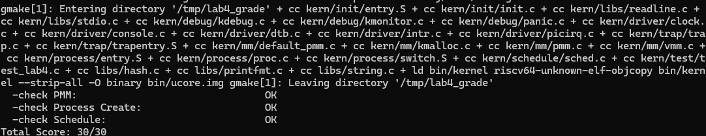
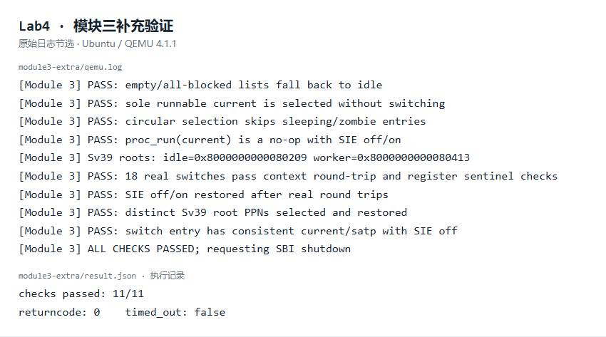

# 操作系统实验报告

## 实验基本信息

| 项目 | 内容 |
|------|------|
| 实验名称 | Lab4：进程管理 |
| 小组成员 | 2413790 姜禧、2410250 张浩正 |
| 完成日期 | 2026-11-19 |
| 实验分支 | `lab4`，基于 `c59698f` 完成模块三 |

### 小组分工

| 成员 | 负责的练习/模块 |
|------|----------------|
| 2413790 姜禧 | 模块一：虚拟内存页操作；模块二：进程创建与初始化 |
| 2410250 张浩正 | 模块三：进程调度；联调、补充测试及截图整理 |

报告按各自负责的模块整理。本版已写入模块三的实现和验证记录；模块一、二的实现说明依据现有代码与提示词整理，个人调试经历由姜禧补充。

## 一、实验目的

理解页映射、线程创建与调度之间的关系，完成从 idleproc 切换到 initproc 的执行链。掌握 PCB、内核栈、trapframe 和 context 的分工，并用明确的接口约束与测试检查 AI 生成的代码。

## 二、实验环境

实际在 WSL Ubuntu 24.04.4 LTS 中编译、运行，目标为 RISC-V 64 位，使用 QEMU **4.1.1**、`riscv64-unknown-elf-gcc 13.2.0` 和 `gdb-multiarch 15.1`。

| 成员 | AI 编程工具 | 底层模型 |
|------|------------|---------|
| 2413790 姜禧 | VS Code、Codex | ChatGPT 6 |
| 2410250 张浩正 | VS Code、Codex | ChatGPT 6 |

工具与模型名称沿用小组记录。QEMU 安装于 `~/.local/opt/qemu-4.1.1/bin/`。原评分使用 `riscv64-unknown-elf-gdb`，本地通过同名脚本调用 `gdb-multiarch`，在连接前执行 `set architecture riscv:rv64`；原评分脚本未修改。

## 三、实验整体逻辑分析

前面的实验分别建立了启动与调试环境、物理页管理能力以及异常和中断处理机制。本次在这些基础上创建内核线程，并让 CPU 切换到线程的执行现场。

实现顺序是：先通过 `page_insert/page_remove` 维护映射、引用计数和 TLB；再通过 `proc_init/kernel_thread/do_fork` 创建 PCB、内核栈及首次运行现场；最后由调度器选择可运行线程并完成切换。

```text
kern_init → pmm_init → pic_init/idt_init → vmm_init → proc_init
          → clock_init/intr_enable → cpu_idle → schedule → proc_run
          → switch_to → forkret → forkrets → __trapret
          → sret → kernel_thread_entry → init_main
```

`idleproc` 接管启动时已有的执行现场，PID 为 0，使用 bootstack；`initproc` 的 PID 为 1，拥有新分配的内核栈。二者共享内核页表。实际 `proc_list` 不包含 idleproc，调度器将它作为无可运行线程时的回退目标。

## 四、实验内容与实现

### 功能模块一：虚拟内存页操作

**负责人：2413790 姜禧。** 实现位于 `code/kern/mm/pmm.c`。

```c
int page_insert(pde_t *pgdir, struct Page *page, uintptr_t la, uint32_t perm);
void page_remove(pde_t *pgdir, uintptr_t la);
```

`page_insert` 先取得页表项，再区分新映射、同页更新和替换旧页。同页更新权限时引用计数不变；换页时增加新页引用，写入新 PTE 并刷新 TLB，再减少旧页引用，归零则释放。`page_remove` 对未映射地址直接返回；存在映射时清空 PTE、刷新 TLB，再减少引用并按需释放。

**Spec 与提示词设计：** 前置条件约定页表和物理页有效；后置条件约定成功建立映射或返回 `-E_NO_MEM`，删除不存在的映射应安全返回。重点约束页表项、引用计数和 TLB 一致，并明确复用 `get_pte/pte_create` 等接口。完整四段式提示词保留在 [prompt.md 的模块一](prompt.md#功能模块一虚拟内存页操作功能)。

**迭代与结果：** 本次保留该模块已有实现，原评分中 PMM 项通过。此前生成代码时遇到的具体问题及修正过程，待负责人按实际记录补充。

### 功能模块二：进程创建与初始化

**负责人：2413790 姜禧。** 实现位于 `code/kern/process/proc.c`。

```c
static struct proc_struct *alloc_proc(void);
void proc_init(void);
int kernel_thread(int (*fn)(void *), void *arg, uint32_t clone_flags);
int do_fork(uint32_t clone_flags, uintptr_t stack, struct trapframe *tf);
static void copy_thread(struct proc_struct *proc, uintptr_t stack, struct trapframe *tf);
static int copy_mm(uint32_t clone_flags, struct proc_struct *proc);
```

`alloc_proc` 分配并清零 PCB，设置初始状态和内核页表。`proc_init` 建立 idleproc，再创建 initproc。`kernel_thread` 将函数、参数和入口分别写入临时 trapframe 的 s0、s1、epc；`do_fork` 完成 PCB、内核栈、现场、PID 和链表登记，最后唤醒线程，失败时清理已分配资源。

`copy_thread` 将 trapframe 放到新线程栈顶附近，设置 `context.ra=forkret`、`context.sp=tf`。`copy_mm` 保留接口并返回成功，本实验没有复制用户地址空间。初始 trapframe 设置 SPP、SPIE 并清除 SIE，使首次恢复经过 `sret` 后进入 S 态并开启对应中断使能。

**Spec 与提示词设计：** 从“内存管理和启动现场已经就绪”出发，约定返回有效 PCB/PID 或错误码，明确失败清理与登记顺序；在 RELY 中写清结构体、栈布局和首次运行链，避免各函数独立生成后无法衔接。完整提示词见 [prompt.md 的模块二](prompt.md#功能模块二进程创建及初始化功能)。

**迭代与结果：** 本次保留该模块已有实现，原评分中 Process Create 项通过。此前的生成与调试经历留给负责人补充。

### 功能模块三：进程调度

**负责人：2410250 张浩正。** 修改 `proc.c`、`sched.c`、`switch.S`，保留 LAB4 注释并填写学号。

```c
void cpu_idle(void);
void schedule(void);
void proc_run(struct proc_struct *proc);
void switch_to(struct context *from, struct context *to);
```

| 函数 | 实现与关键边界 |
|------|----------------|
| `cpu_idle` | 持续检查 `current->need_resched`，置位时调用 `schedule` |
| `schedule` | 保存中断状态并关中断，清除重调度标记；从当前节点之后循环寻找 `PROC_RUNNABLE`，idle 从表头查找；找不到则选 idle。增加目标 `runs`，目标与当前不同才切换 |
| `proc_run` | 同线程直接返回；否则在临界区更新 `current`、写入 Sv39 `satp`、刷新 TLB，然后调用 `switch_to`。旧线程以后被切回来时，继续执行并恢复原中断状态 |
| `switch_to` | 用 a0/a1 指向旧/新 context，按结构布局保存和恢复 `ra、sp、s0—s11`，最后 `ret` |

`pgdir` 保存根页表的物理地址，写入值为 `((uintptr_t)SATP_MODE_SV39 << 60) | (pgdir >> RISCV_PGSHIFT)`。先转为 64 位再移位，ASID 为 0；随后 `flush_tlb()` 执行 `sfence.vma`。遗留的 Sv32 `lsatp` 不适用于本实验。

RV64 下 context 的 14 个字段共 112 字节，ra、sp 和 s0—s11 的偏移依次为 0、8、16…104。切换发生在函数调用边界，调用者负责保留仍需使用的 caller-saved 值，汇编保存 s0—s11，并额外保存恢复执行所需的 ra、sp。ra 本身属于 caller-saved，不能把这 14 个寄存器都称为 callee-saved。寄存器分类见 [RISC-V ABI](https://riscv-non-isa.github.io/riscv-elf-psabi-doc/#_integer_register_convention)。

首次运行的新线程没有“上一次 switch_to 调用”，因此模块二提前构造 `context.ra` 与 trapframe，使它沿 `forkret → forkrets → __trapret → kernel_thread_entry` 进入线程函数。已有线程则恢复到原来的调用位置继续执行。

#### 最终提示词与 Spec

四段式分别说明任务、可依赖接口、实现范围和前后置条件。模块三的关键约束是循环选择规则、切换过程的原子性、Sv39 编码及 14 个寄存器的布局。完整提示词及补测、排查提示词见 [prompt.md](prompt.md#功能模块三进程调度)。核心内容如下：

```text
[PROMPT]
完成 Lab4 模块三，在 proc.c、sched.c 和 switch.S 中实现进程调度。
保留模块一、二和原评分测试，把模块三的 YOUR CODE 改为 2410250。
在 Ubuntu、QEMU 4.1.1 下验证，保存关键截图和原始日志。

[RELY]
使用实际 proc_struct、context、proc_list 和中断保护接口。
pgdir 为页表物理地址，satp 按 Sv39 编码，参考 enable_paging。
新线程的初始现场已由模块二准备好。

[GUARANTEE]
实现 cpu_idle、schedule、proc_run、switch_to，保持函数签名。

[SPECIFICATION]
前置：进程链表、页表、内核栈和目标现场有效。
按 need_resched 触发调度，循环寻找 runnable 线程，无目标则回退 idle。
关中断后更新 current、页表和现场，恢复执行后还原原中断状态。
按 context 布局保存并恢复 ra、sp、s0—s11。
后置：选择合法，current 与页表一致，线程能从正确位置继续执行。
```

#### 实现迭代过程

1. **基线检查：** 拉取的代码尚缺模块三，编译出现 `undefined reference to cpu_idle`。按接口补齐四个函数后首次编译及普通启动通过，initproc 正确输出。此后未因测试结果修改生产实现。
2. **原评分排查：** 初次评分为 `0/30`，没有串口输出。先发现缺少评分要求的 GDB 命令名；链接到 gdb-multiarch 后仍报 `Architecture rejected target-supplied description`、`Truncated register 37`。在本地 GDB 包装脚本中预先指定 `riscv:rv64` 后，原评分得到 `30/30`。这是工具连接问题，评分脚本和断言均保留。
3. **补测修正：** 独立测试最初把值为 8 的 `SATP_MODE_SV39` 直接作为模式位比较，遗漏左移 60 位，导致断言失败。核对项目定义后修正测试期望，生产代码无须修改；重跑后 11 项检查全部通过。首次失败日志保留在外部证据目录。

### Challenge：中断保护与分页模式

`local_intr_save(intr_flag)` 读取 `sstatus.SIE`，记录原状态并按需关中断；`local_intr_restore(intr_flag)` 仅在原来开启时重新开启。这样嵌套临界区不会提前开中断。调度期间保护 `current`、页表与现场的一致性；这是单核上的本地中断保护，多核还需要锁等同步机制。

| 模式 | 页表级数 | 每级索引位数 | PTE 大小 | 基础页大小 |
|------|----------|--------------|----------|------------|
| Sv32 | 2 | 10 | 4 字节 | 4 KiB |
| Sv39 | 3 | 9 | 8 字节 | 4 KiB |
| Sv48 | 4 | 9 | 8 字节 | 4 KiB |

它们都逐级索引页表，最后用 12 位页内偏移定位。当前 Sv39 `get_pte` 的两段相似代码分别处理上面两级：检查表项、按需分配并清零下一层页表、写入物理页号；再用最低一级索引返回叶子 PTE 地址。分页结构与 satp 编码参见 [RISC-V Supervisor 规范](https://docs.riscv.org/reference/isa/priv/supervisor.html)。

将查找和分配合在 `get_pte(pgdir, la, create)` 中便于复用，`create=false` 可以只查询。缺点是查询接口可能带来分配副作用，失败回滚不够直观。当前教学实现可以保留；扩展到复杂地址空间时可提供独立查找/确保存在接口，内部共享页表遍历代码，并明确中间页表分配失败时的回滚责任。

## 五、测试与验证

在 Ubuntu 项目的 `code` 目录执行：

```bash
export PATH="$HOME/.local/opt/qemu-4.1.1/bin:$HOME/.local/bin:$PATH"
qemu-system-riscv64 --version
make -j2
make qemu
make grade
python3 tools/check_module3.py --qemu qemu-system-riscv64
```

本机 `~/.local/bin/riscv64-unknown-elf-gdb` 内容如下；复现者若使用能直接识别 RV64 的交叉 GDB，可使用自己的对应工具。

```sh
#!/bin/sh
exec /usr/bin/gdb-multiarch -ex 'set architecture riscv:rv64' "$@"
```

| 验证 | 实际结果 |
|------|----------|
| 编译与普通启动 | 编译退出码 0；成功切换到 initproc，输出 PID、名称与字符串 |
| 原评分 `make grade` | PMM、Process Create、Schedule 均为 OK，总分 **30/30**，退出码 0 |
| 独立补测 | 8 项内核行为检查及 3 项运行完整性检查全部通过；18 次真实切换；QEMU 自然退出 0，无超时 |

补测前三项构造链表并捕获 `proc_run`，检查空表/全阻塞回退、仅当前线程和循环选择；后续创建真实内核线程，检查同线程不切换、上下文往返、寄存器哨兵、SIE 恢复和不同根页表 PPN 的切换。寄存器哨兵属于经过 C 调用链的端到端检查，14 个汇编槽位的布局另以代码复核确认。两个根页表保留相同内核映射，测试验证页表选择与恢复，不代表已实现用户地址空间隔离。测试只注入临时副本，原评分和正常启动代码未改动。

以下三张图片为真实日志节选的排版截图，省略重复构建信息。原始日志及 JSON 保存在项目同级 `lab4-evidence`，截图中退出码来自对应运行记录。


普通启动末尾的 `process exit!!` 来自已有 `do_exit` 占位实现。init_main 返回后触发该 panic，随后 kmonitor 调用 SBI 关机，QEMU 自然退出 0。它说明退出流程尚未实现，不能将这次运行解释为完整的线程资源回收。





## 六、实验总结与收获

### 对操作系统的理解

| 实验知识点 | 对应 OS 原理及联系、差异 |
|------------|------------------------|
| 页映射、引用计数与 TLB | 对应地址翻译和共享页管理；修改内存中的 PTE 后还需使缓存翻译失效。本实验没有按需调页 |
| PCB、内核栈和线程创建 | 对应进程执行环境；本次线程共享内核地址空间，尚未拥有独立用户空间 |
| schedule 与 switch_to | 分别承担选择策略和切换机制；按链表循环选 runnable，尚无时间片抢占和优先级策略 |
| context 与 trapframe | 前者保留函数调用边界的切换现场，后者用于异常返回及构造首次入口，保存范围与用途不同 |
| 中断临界区 | 对应并发访问一致性；本地关中断能保护本实验单核切换，多核互斥需要进一步同步 |

本实验尚未覆盖用户进程加载、系统调用隔离、缺页处理与页面置换、完整 exit/wait 资源回收、抢占调度、优先级及多核负载均衡等重要内容。

### AI 协作开发的经验

提示词需要写清数据结构和前后置条件，尤其是页表地址的单位、寄存器偏移和中断恢复时机。验证时分别检查实现、测试期望和工具环境：一次 `0/30` 可能来自调试连接失败，断言失败也可能来自测试公式错误。保留原测试与原始日志，才能根据实际执行过程定位问题。
