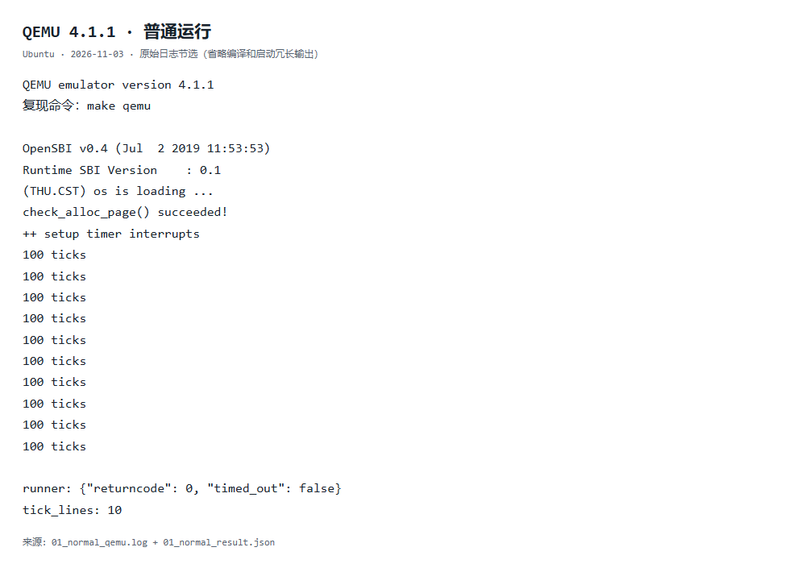
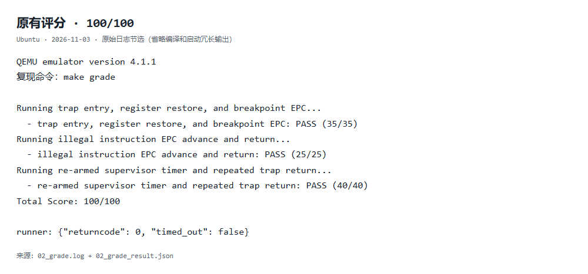
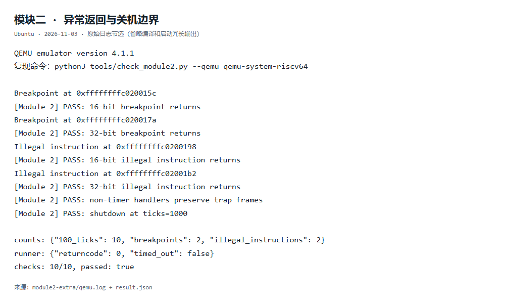

# 操作系统实验报告

## 实验基本信息

| 项目 | 内容 |
| --- | --- |
| 实验名称 | Lab3：中断与异常处理 |
| 小组成员 | 2413790-姜禧、2410250-张浩正 |
| 完成日期 | 2026-11-03 |

### 小组分工

| 成员 | 负责内容 |
| --- | --- |
| 姜禧 2413790 | 功能模块一：Trap 入口与上下文恢复；补充本模块个人实现过程。 |
| 张浩正 2410250 | 功能模块二：中断与异常处理、QEMU 4.1.1 环境切换及集成验证。 |

本稿整理整体流程、模块二实现和本次集成结果，模块一的个人调试记录由姜禧继续完善。

## 一、实验目的

理解 RISC-V Trap 的进入、分发和返回，完成时钟中断、非法指令与断点异常处理，并验证处理后能恢复原执行流。

## 二、实验环境

| 项目 | 实际环境 |
| --- | --- |
| 系统 | WSL Ubuntu 24.04 |
| 模拟器 | QEMU 4.1.1，用户目录隔离安装，带调试符号 |
| 固件 | QEMU 默认 OpenSBI 0.4，SBI 0.1 |
| 交叉编译器 | riscv64-unknown-elf-gcc 13.2.0 |
| 工具与模型 | VS Code、Codex、ChatGPT 6 |

QEMU 位于 `~/.local/opt/qemu-4.1.1/bin/qemu-system-riscv64`，通过 `~/.local/bin` 及 PATH 使用。系统原有 8.2.2 保留。评分脚本直接调用 `qemu-system-riscv64`，所以普通运行与评分均显式使用同一版本路径。

## 三、实验整体逻辑

Lab1 完成内核启动，Lab2 建立基本物理内存管理和启动映射，Lab3 在此基础上处理突发事件：

```text
idt_init 设置 stvec → clock_init 预约时钟事件 → intr_enable
→ 发生 Trap，硬件记录 sepc/scause 等状态
→ __alltraps / SAVE_ALL 保存通用寄存器及相关 CSR
→ trap(tf) → trap_dispatch → interrupt_handler / exception_handler
→ __trapret / RESTORE_ALL → sret 恢复执行
```

硬件记录 Trap 原因和返回位置，软件负责保存、恢复通用寄存器。同步异常由当前指令触发；时钟中断是异步事件。两者共用入口，但返回位置的处理不同。

## 四、实验内容与实现

### 功能模块一：Trap 入口与上下文恢复

负责人：2413790 姜禧。

已拉取的实现以现有 `SAVE_ALL` 和 `trapframe` 为依据：`__alltraps` 将当前栈上的 Trap frame 地址放入 a0，调用 `trap(tf)`；返回后恢复 sstatus、sepc 和通用寄存器。sp 最后恢复，避免提前失去 Trap frame 的寻址基址，随后执行 `sret`。本次保留该实现，并用原有上下文评分检验它与模块二的衔接。

规格以已有 `SAVE_ALL` 和 `trapframe` 布局为依据：入口的前置条件是 CPU 已跳入、现场尚待保存，后置条件是把完整现场传给 `trap()`；恢复的前置条件是 sp 指向有效现场，后置条件是按处理后的现场恢复寄存器并执行返回。提示词据此约束参数传递、sp 的特殊恢复顺序和已有接口，见 [prompt.md](prompt.md#功能模块一trap-上下文恢复与-trap-入口功能)。

### 功能模块二：中断与异常处理

负责人：2410250 张浩正。

实现文件为 [trap.c](../code/kern/trap/trap.c)，补齐：

```c
void interrupt_handler(struct trapframe *tf);
void exception_handler(struct trapframe *tf);
```

**中断处理。** 清除 cause 的最高中断标志位后识别类型。S 态时钟中断先预约下一次事件，再让 ticks 增加一次；每满 100 次调用原 `print_ticks()`。指导书提到了 `SHUTDOWN_AFTER`，但分支未定义数值，本实现取 10，即打印十次、累计 1000 ticks 后调用 `sbi_shutdown()`。其他已知中断输出类型，未知中断输出原因和完整 Trap frame；这些处理不修改 epc。

**异常处理。** 非法指令输出 `Illegal instruction at`，断点输出 `Breakpoint at`，随后读取异常指令的首半字，根据低两位区分本实验的 16/32 位编码，使 epc 前进 2/4 字节。这样支持压缩和非压缩断点，避免固定偏移造成重复异常或跳过后续指令。其他异常调用 `print_trapframe()`，保留 epc。本实现面向实验中的 RV64I/C 指令，不宣称支持任意更长编码的非法指令恢复。

**规格与提示词设计。** `[RELY]` 以实际 Trap frame、时钟和 SBI 接口为依据，`[GUARANTEE]` 列出两个处理函数，`[SPECIFICATION]` 区分有效现场这一前提、时钟重新预约与计数、异常长度推进，以及未知类型的兜底行为。完整提示词见 [prompt.md](prompt.md#功能模块二中断与异常处理)。

### 实现与调试记录

1. 拉取分支后先构建，出现两个 handler 的隐式声明错误，原因是模块二仍为空；原始失败日志已保留。补齐两个函数并引入 SBI 头文件后编译通过。该问题发生在模块二尚未实现时。
2. QEMU 4.1.1 在当前 Ubuntu 下完成隔离构建，无需修改 QEMU 源码。为兼容旧代码警告，构建 QEMU 时使用 `--disable-werror`；实验内核仍保留原有 `-Werror`。切换 PATH，保证原评分脚本也使用 4.1.1。
3. 完成后的第一轮普通运行和原评分通过。原评分没有覆盖两种长度的全部异常，也没有单独断言关机时机，因此增加独立补测，保留原测试及其判分条件。本次生成后的模块二在这些实测中未发现额外逻辑错误。

### 思考：do { ... } while (0) 的作用

它把多条语句组成语法上的单条语句，允许宏调用后正常加分号，并避免放进 `if/else` 时产生错误的语句绑定。条件为 0，宏体只执行一次。`local_intr_save` 保存原来的中断状态并关中断，恢复时遵循原状态，不能无条件重新开中断。该机制用于本 CPU 的临界区，不替代多核同步锁。

## 五、测试与验证

在 Ubuntu 的 `~/os/lab3/code` 执行。为确保脚本使用同一个版本，可先设置：

```bash
export PATH="$HOME/.local/opt/qemu-4.1.1/bin:$PATH"
qemu-system-riscv64 --version
make clean
make qemu
make grade
python3 tools/check_module2.py --qemu qemu-system-riscv64
```

普通内核会自行关机，退出后再执行下一条命令。

| 验证项 | 实际结果 |
| --- | --- |
| 干净构建与普通运行 | 编译成功；十行 `100 ticks` 后 QEMU 自然退出，退出码 0，未超时 |
| 原评分 | 上下文/断点 35/35，非法指令/兜底 25/25，持续时钟 40/40；总分 100/100 |
| 独立补充测试 | 16/32 位断点和非法指令均成功返回；其他处理保留现场；1000 ticks 时关机，十项检查全部通过 |

补测在临时工程副本中执行，四种异常由真实指令触发；其他非时钟中断的分类和兜底通过直接调用 handler 检查。测试在 SBI 关机调用处断言 `ticks == 1000`，随后执行原关机函数，并检查 QEMU 自然退出。

以下图片是原始运行日志节选的浏览器截图；完整日志保存在 Ubuntu 的 `~/os/lab3-evidence/`。







## 六、实验总结与收获

| 实验知识点 | 对应 OS 原理与区别 |
| --- | --- |
| Trap frame 与汇编恢复 | 对应上下文保存恢复；本实验恢复被打断的内核执行流，尚未实现进程切换 |
| cause 分类与委托 | 对应中断、异常及特权级处理；硬件决定入口与基本状态，内核完成具体分发 |
| epc 与 sret | 对应异常返回；主动跳过已处理异常指令，时钟中断保留恢复位置 |
| 时钟重新预约、ticks 计数 | 对应周期事件和计时基础；本实验没有进一步实现调度和时间片分配 |
| 本地关中断 | 对应临界区保护；多核共享数据还需其他同步机制 |

本实验未覆盖完整系统调用、用户态切换、进程调度、完整缺页恢复、设备驱动和多核同步。AI 协作中需要先明确现场布局、返回位置和计数约定，再用实际执行和断言验证；编译通过只能说明接口接通，不能代替异常返回和持续时钟的运行检查。
