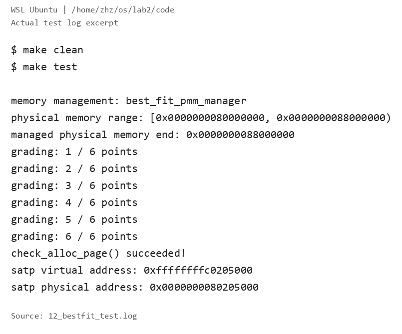
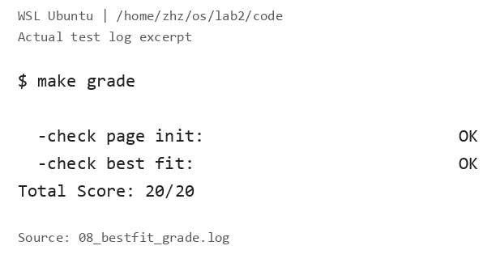
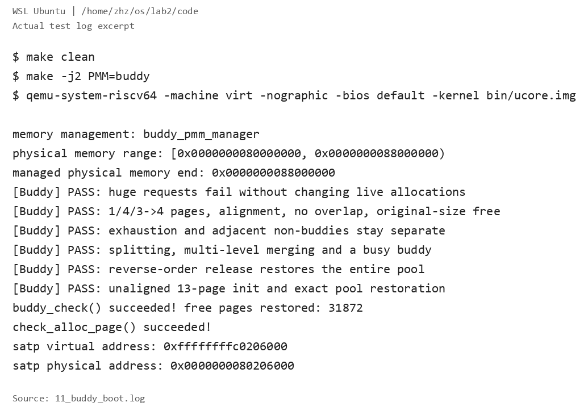

# 操作系统实验报告

## 实验基本信息

| 项目 | 内容 |
| --- | --- |
| **实验名称** | Lab2：物理内存管理 |
| **小组成员** | 2413790-姜禧、2410250-张浩正 |
| **整理日期** | 2026-10-22 |

### 小组分工

| 成员 | 负责的练习/模块 |
| --- | --- |
| 2413790-姜禧 | 功能模块一：物理内存探测与 Page 描述符初始化。 |
| 2410250-张浩正 | 功能模块二：First-Fit 原理分析、Best-Fit 实现、Buddy 实现及独立测试；运行环境适配与验证。 |

## 一、实验目的

1. 理解物理地址、虚拟地址、物理页号和 Page 描述符的区别，正确组织可用内存。
2. 理解 First-Fit，实现 Best-Fit 连续物理页分配和回收。
3. 实现 Buddy 分配器，通过独立测试验证拆分、合并、边界条件及资源恢复。

## 二、实验环境

| 成员 | AI 编程工具 | 底层模型 | 备注 |
| --- | --- | --- | --- |
| 2413790-姜禧 | VS Code、Codex | ChatGPT 6 | 物理内存初始化。 |
| 2410250-张浩正 | VS Code、Codex | ChatGPT 6 | 辅助模块二实现、调试及测试整理。 |

本次集成验证在 WSL Ubuntu 中进行，项目目录为 `~/os/lab2/code`。使用 RISC-V 交叉编译工具链、QEMU 8.2.2、OpenSBI 1.3 和 `gdb-multiarch`。默认启用 Best-Fit，通过 `PMM=buddy` 切换 Buddy，切换配置前清理构建产物。

## 三、实验整体逻辑分析

### 3.1 本章节的逻辑主线

Lab1 建立了最小内核的启动和输出流程；Lab2 在此基础上让内核知道哪些物理页可用，并按请求分配和回收页面。调用关系为：

```text
启动、设备树解析
  → pmm_init
  → init_pmm_manager：选择并初始化分配器
  → page_init：建立页描述符、保留已用内存
  → init_memmap：注册剩余完整空闲页
  → alloc_pages / free_pages：分配与回收
  → 管理器 check：验证功能与状态恢复
```

### 3.2 功能的逐步实现

模块一先确定可管理范围，排除 OpenSBI、内核和描述符数组占用的空间。模块二通过统一的 `pmm_manager` 接口管理这些可用页：先理解 First-Fit，再实现 Best-Fit，最后实现按幂次块组织内存的 Buddy。只有初始页面状态正确，后续分配算法的检查结果才有意义。

## 四、实验内容与实现

### 功能模块一：物理内存初始化

**负责人：** 2413790-姜禧。

#### 模块功能描述

主要实现位于 [pmm.c](../code/kern/mm/pmm.c)：

```c
static void page_init(void);
```

`page_init()` 读取 `get_memory_base()` 和 `get_memory_size()` 提供的设备树内存信息，检查无效范围和加法溢出，并结合 `PHYSICAL_MEMORY_END` 确定按页向下对齐的可管理上界。

函数设置虚实地址偏移 `va_pa_offset`，将 `pages` 放在内核 `end` 之后的页对齐位置。这里 `npage` 保存上界对应的物理页号，描述符数量是 `npage-nbase`。检查描述符数组能够放入内存后，先把所有描述符标为 Reserved；再从数组末尾向上按页对齐，通过 `init_memmap()` 注册剩余完整页面。没有完整空闲页时不调用注册函数，内核和描述符本身始终保留。

本次运行探测到物理内存区间 `[0x80000000, 0x88000000)`，即 128 MiB。本版实现要求内存起点与框架的 `DRAM_BASE` 一致。

#### 最终提示词

**【待姜禧补充】** 模块一实际使用的四段式提示词，并同步到 `prompt.md`。

#### 实现迭代过程

**【待姜禧补充】** 实现中遇到的问题、修改方法和迭代结果。

### 功能模块二：物理内存分配

**负责人：** 2410250-张浩正。

#### 任务一：理解 First-Fit

[default_pmm.c](../code/kern/mm/default_pmm.c) 使用按地址组织的双向空闲链表。`default_init()` 建立空表；`default_init_memmap()` 清理页状态，将连续区域作为空闲块加入链表。块首页的 `property` 记录页数，`PG_property` 标记空闲块首页，`nr_free` 记录空闲页总数。

`default_alloc_pages(n)` 找到第一个足够大的块，取其前 n 页，把剩余部分保留为空闲块。`default_free_pages()` 将释放区按地址插入，再合并前后相邻空闲块。合并只改变块的组织方式，不额外增加空闲页数。

First-Fit 实现简单，但线性查找开销和外部碎片会随空闲块分布变化。可通过更合适的索引或搜索策略减少查找成本，同时保留相邻合并。阅读参考实现时还发现尾插分支缺少及时退出的风险，Best-Fit 使用明确终止的插入逻辑；本次未修改 First-Fit 源码。

#### 任务二：实现 Best-Fit

主要代码为 [best_fit_pmm.c](../code/kern/mm/best_fit_pmm.c)，通过以下函数接入管理器：

```c
static void best_fit_init(void);
static void best_fit_init_memmap(struct Page *base, size_t n);
static struct Page *best_fit_alloc_pages(size_t n);
static void best_fit_free_pages(struct Page *base, size_t n);
static size_t best_fit_nr_free_pages(void);
static void init_pmm_manager(void);  // pmm.c 中选择管理器
```

分配时遍历空闲块，选择满足请求的最小块；大小相同时保留先遇到的低地址块。成功分配恰好 n 页，余块继续挂在链表中；失败返回 NULL，状态不变。回收按地址插入并合并相邻区域，支持原测试中的部分释放和相邻已分配区一起释放。

原有 `basic_check()`、`best_fit_check()` 保持不变，默认管理器切换为 `best_fit_pmm_manager`。测试会直接清空和恢复链表、计数，因此实现不依赖测试无法同步的隐藏空闲索引。

**最终提示词概要：**

```text
[PROMPT] 补全 Best-Fit 模块并默认启用，保留原测试与模块一实现。
[RELY] 使用真实 Page、free_area_t、页状态宏和链表接口，兼容测试的状态切换。
[GUARANTEE] 实现初始化、注册、分配、释放、计数函数及管理器注册。
[SPECIFICATION] n>0；成功返回最小适配块的 n 页，失败不改变状态；
释放后合并相邻块，计数按页更新，测试完成后恢复资源。
```

完整版本见 [prompt.md 第 1 节](prompt.md#1-best-fit)。

Best-Fit 能减少单次分配的剩余空间，但仍可能产生细小碎片，也不保证未来请求的整体效果。改进方向包括按大小建立索引，并协调地址索引以便合并；本次采用便于检查的线性扫描实现。

#### 任务三：实现 Buddy 并设计独立测试

新增 [buddy_pmm.c](../code/kern/mm/buddy_pmm.c)、[buddy_pmm.h](../code/kern/mm/buddy_pmm.h) 和 [buddy_pmm_test.c](../code/kern/mm/buddy_pmm_test.c)。

```c
static void buddy_init(void);
static void buddy_init_memmap(struct Page *base, size_t n);
static struct Page *buddy_alloc_pages(size_t n);
static void buddy_free_pages(struct Page *base, size_t n);
static size_t buddy_nr_free_pages(void);
static void buddy_check(void);
void buddy_validate(void);
void buddy_run_tests(void);
```

Buddy 按阶维护空闲链表，块大小为 2 的幂，按物理页号判断对齐和伙伴关系。初始化将可用区划分为若干对齐块，保留不对齐前缀和尾部零头。申请 n 页时向上取整为 m 页，必要时逐级拆分；释放使用原始 base 和原始 n，由记录的请求信息确定实际块大小，归还整块并逐级合并同阶空闲伙伴。相邻但不互为伙伴的块不合并。

空闲页数按实际 m 页增减。例如申请 3 页会占用 4 页，释放时仍传入原始请求 3。这个约定产生内部碎片，并要求整块释放；它与 Best-Fit 的任意连续已分配区释放约定不同。`struct Page` 和模块一的初始化接口保持不变。

**算法提示词概要：**

```text
[PROMPT] 新增 Buddy 模块，通过 PMM=buddy 接入，默认保留 Best-Fit。
[RELY] 沿用 pmm_manager；可用区可能不对齐、长度可能不是 2 的幂。
[GUARANTEE] 实现管理器各函数、buddy_check 和内部状态检查接口。
[SPECIFICATION] 请求向上取整；仅接受原始 base/n 释放；
实际页数守恒，拆分不丢页，仅合并真实伙伴，失败不改变已有分配。
```

完整版本见 [prompt.md 第 2 节](prompt.md#2-buddy-system)。

**独立测试提示词概要：**

```text
[PROMPT] 为 Buddy 新增独立测试，保持 Best-Fit 原测试和评分标准。
[RELY] 采用实际舍入和释放约定，在无其他活动分配的启动阶段运行。
[GUARANTEE] 实现 buddy_run_tests，由 buddy_check 调用。
[SPECIFICATION] 断言验证大小、对齐、不重叠、拆分合并、耗尽及边界；
回收全部测试分配，恢复原可用范围和页数，再回归默认评分。
```

完整版本见 [prompt.md 第 3 节](prompt.md#3-buddy-独立测试)。

测试采用受控真实页区域检查不对齐的 13 页初始化，并验证巨大请求失败、耗尽、相邻非伙伴、占用中的伙伴及多级合并。独立的 `buddy_validate()` 检查链表、覆盖、对齐、标志和计数一致性；恢复过程实际释放和重新注册原可用区，随后再次分配验证，避免仅凭打印或重置计数认定成功。

#### 实现与调试过程

初始分支的 Best-Fit 仅有测试和占位注释，补全实现后保持两项原测试不变；随后接入 Buddy，并用独立测试验证其整块分配语义。

启动调试中，旧 loader 命令使 OpenSBI 的 Next Address 为 0；改用 `-kernel` 后到达内核入口，但开启 Sv39 时低地址执行流缺少映射。为此在启动页表中补充低地址恒等映射，保留原高地址映射，使 CPU 能继续执行并跳转到高地址内核。同步适配 QEMU、GDB 和评分脚本的启动命令，并在评分退出时回收本次 QEMU 进程。对应提示词见 [prompt.md 第 4 节](prompt.md#4-启动兼容修正)。

上述改动未修改 `page_init()` 实现、原测试断言或评分通过条件。

## 五、测试与验证

在 `code` 目录分别构建默认配置和 Buddy 配置。复现时可执行：

```bash
make clean
make test
# 观察 Best-Fit 自检结果后退出 QEMU，再执行：
make grade

make clean
make PMM=buddy
make PMM=buddy qemu
# 观察 Buddy 结果并退出 QEMU 后，切回默认配置：
make clean
make
make grade
```

内核完成检查后进入无限循环，观察结果后退出 QEMU。

| 验证项 | 实际结果 | 说明 |
| --- | --- | --- |
| 默认启动 | `memory management: best_fit_pmm_manager`；`check_alloc_page() succeeded!` | 正确选择管理器并完成原自检。 |
| Best-Fit 详细自检 | `grading: 6 / 6 points` | 由带测试输出的构建记录确认。 |
| 默认 `make grade` | page-init、best-fit 均 OK，`Total Score: 20/20` | 仅对应默认配置的模块一和 Best-Fit 评分，不包含 Buddy。 |
| Buddy 独立测试 | 六组 PASS，`buddy_check() succeeded!` | 覆盖请求大小、对齐、互不重叠、失败、耗尽、拆分合并及初始化边界。 |
| Buddy 资源恢复 | `free pages restored: 31872` | 本次构建的实际空闲页数恢复，具体值会随内核布局变化。 |







## 六、实验总结与收获

### 对操作系统的理解

| 实验知识点 | 对应原理及联系、区别 |
| --- | --- |
| 页描述符与保留区 | 对应资源管理元数据：描述符记录页状态，本身也占内存，必须排除出可分配范围。 |
| 地址转换与启动页表 | 对应虚拟内存映射：虚拟地址、物理地址和页号用途不同；本次使用静态启动映射，尚未实现完整动态页表管理。 |
| First-Fit、Best-Fit | 对应连续分配与外部碎片：不同搜索策略影响剩余空闲块，相邻合并减少碎片，但总空闲页足够不代表存在足够大的连续块。 |
| Buddy | 对应按幂次组织资源：拆分和伙伴合并方便，非幂次请求会有内部碎片，空闲页计数必须反映实际块大小。 |
| 状态检查与回收测试 | 对应分配器不变量：成功返回、区间不重叠、失败无副作用及资源恢复需要共同验证。 |

本次尚未实现进程调度、用户态地址空间、缺页处理与页面置换、文件系统和完整同步机制。

### AI 协作开发的经验

模块二使用四段式提示词明确接口、状态和前后置条件，尤其先说明 Best-Fit 与 Buddy 的释放约定，再分别设计验证方式。实际调试表明，算法检查前还要确认镜像加载和分页过渡正常；结论应来自代码、断言和原始输出。
