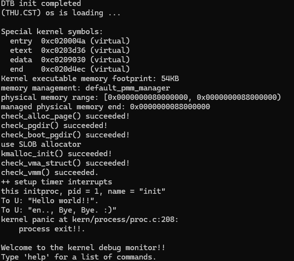

# 操作系统实验报告

## 实验基本信息

| 项目 | 内容 |
|------|------|
| 实验名称 | Lab4：进程管理 |
| 小组成员 | 2413790 姜禧、2410250 张浩正 |
| 完成日期 | 2026-11-19 |

### 小组分工

| 成员 | 负责的练习/模块 |
|------|----------------|
| 2413790 姜禧 | 模块一：虚拟内存页操作；模块二：进程创建与初始化 |
| 2410250 张浩正 | 模块三：进程调度；联调、补充测试及截图整理 |

报告按各自负责的模块整理。姜禧负责模块一和模块二的功能分析、规格设计与实现过程，张浩正负责模块三的实现说明与测试记录，共同整理整体逻辑和实验总结。

## 一、实验目的

理解页映射、线程创建与调度之间的关系，完成从 idleproc 切换到 initproc 的执行链。掌握 PCB、内核栈、trapframe 和 context 的分工，并用明确的接口约束与测试检查 AI 生成的代码。

## 二、实验环境

| 成员 | AI 编程工具 | 底层模型 | 备注 |
|------|------------|---------|------|
| 2413790 姜禧 | VS Code、Codex | ChatGPT 6 | 页映射维护、内核线程创建与初始化 |
| 2410250 张浩正 | VS Code、Codex | ChatGPT 6 | 进程调度、上下文切换与补充测试 |

## 三、实验整体逻辑分析

### 3.1 从内核启动到第一个内核线程

Lab2 为内核提供了物理页分配和基础页表，Lab3 实现了从栈上恢复寄存器并执行 `sret` 的过程。Lab4 把这两部分用在了新线程上。内核启动时已经在使用启动栈执行代码，`proc_init()` 给这段正在运行的执行流建立 PCB，记作 PID 0 的 idleproc。随后内核创建 PID 1 的 initproc，为它分配独立的内核栈，并在栈上放好第一次运行需要的寄存器值。两个线程共享内核页表。

从启动到串口打印 `Hello world!!`，主要经过以下步骤：

```text
kern_init()
  → pmm_init() → pic_init() → idt_init() → vmm_init()
  → proc_init()                      建立 idleproc，创建并登记 initproc
  → clock_init() → intr_enable()
  → cpu_idle() → schedule()          idleproc 请求调度，选中 initproc
  → proc_run() → switch_to()         切换到 initproc 的内核栈和执行现场
  → forkret → forkrets → __trapret → sret
  → kernel_thread_entry → init_main  取出创建时传入的参数并打印
```

### 3.2 三个模块怎样衔接

1. **维护页映射。** 模块一在已有页表上建立、替换或撤销映射。映射改变时，内核还要处理物理页的引用计数，并让旧的 TLB 翻译失效。后面创建内核线程时直接使用已有内核页表，无须为每个线程重新建立一套映射。
2. **准备可运行的线程。** 模块二由 `kernel_thread()` 包装线程函数和参数，再由 `do_fork()` 分配 PCB、内核栈并填好初始现场。准备完成后，initproc 才进入进程链表并被标记为可运行。此时 CPU 仍在执行 idleproc。
3. **完成首次切换。** 模块三由 `schedule()` 选出 initproc，再由 `proc_run()` 和 `switch_to()` 切换执行现场。initproc 从未运行过，恢复的返回地址和栈指针来自模块二预先填写的 `context`。沿着这个入口恢复 trapframe 后，CPU 才真正开始执行 `init_main()`。

## 四、实验内容与实现

### 功能模块一：虚拟内存页操作

**负责人：2413790 姜禧。** 实现见 [pmm.c](../code/kern/mm/pmm.c)。

```c
int page_insert(pde_t *pgdir, struct Page *page, uintptr_t la, uint32_t perm);
void page_remove(pde_t *pgdir, uintptr_t la);
```

`page_insert` 先取得页表项，再区分新映射、同页更新和替换旧页。同页更新权限时引用计数不变；换页时增加新页引用，写入新 PTE 并刷新 TLB，再减少旧页引用，归零则释放。`page_remove` 对未映射地址直接返回；存在映射时清空 PTE、刷新 TLB，再减少引用并按需释放。

**Spec 与提示词设计：** 前置条件约定页表和物理页有效；后置条件约定成功建立映射或返回 `-E_NO_MEM`，删除不存在的映射应安全返回。重点约束页表项、引用计数和 TLB 一致，并明确复用 `get_pte/pte_create` 等接口。完整四段式提示词保留在 [prompt.md 的模块一](prompt.md#功能模块一虚拟内存页操作功能)。

写 spec 时，我把“原地址已经有映射”拆成两种情况。同一个地址再次指向同一页时，即使这次增加了写权限，映射数也没有增加。于是代码仍用 `pte_create` 重写权限并使 TLB 失效，但跳过引用计数的增减。换成另一页时则需要先让新映射生效，再放掉旧页的引用，否则物理页有可能已经回到空闲链表，CPU 却还保留着旧地址翻译。

插入和删除对缺页表的处理也不同。我在提示词里明确指定插入用 `get_pte(pgdir, la, 1)`，允许分配中间页表；返回空指针时直接报告内存不足，不写目标叶子项。删除用 `get_pte(pgdir, la, 0)`，查不到页表或发现叶子项无效就返回。这样连续删除同一个地址也不会多释放一次物理页。

**编译与验证。** 单独编译 `pmm.c` 通过后，PMM 评分测试进一步检查了引用计数：两个虚拟地址映射到同一物理页时计数为 2，只更新同一映射的权限时计数保持不变。测试还对同一地址连续调用两次 `page_remove()`，最后 PMM 项输出 `OK`。

### 功能模块二：进程创建与初始化

**负责人：2413790 姜禧。** 实现见 [proc.c](../code/kern/process/proc.c)。

```c
static struct proc_struct *alloc_proc(void);
void proc_init(void);
int kernel_thread(int (*fn)(void *), void *arg, uint32_t clone_flags);
int do_fork(uint32_t clone_flags, uintptr_t stack, struct trapframe *tf);
static void copy_thread(struct proc_struct *proc, uintptr_t stack, struct trapframe *tf);
static int copy_mm(uint32_t clone_flags, struct proc_struct *proc);
```

`alloc_proc` 分配并清零 PCB，设置初始状态和内核页表。`proc_init` 建立 idleproc，再创建 initproc。`kernel_thread` 将函数、参数和入口分别写入临时 trapframe 的 s0、s1、epc；`do_fork` 完成 PCB、内核栈、现场、PID 和链表登记，最后唤醒线程，失败时清理已分配资源。

`copy_thread` 将 trapframe 放到新线程栈顶附近，将 `context.ra` 设为 `forkret`，让 `context.sp` 指向新线程栈上的 `proc->tf`。`copy_mm` 保留接口并返回成功，本实验没有复制用户地址空间。初始 trapframe 设置 SPP、SPIE 并清除 SIE，使首次恢复经过 `sret` 后进入 S 态并开启对应中断使能。

**Spec 与提示词设计：** 从“内存管理和启动现场已经就绪”出发，约定返回有效 PCB/PID 或错误码，明确失败清理与登记顺序；在 RELY 中写清结构体、栈布局和首次运行链，避免各函数独立生成后无法衔接。完整提示词见 [prompt.md 的模块二](prompt.md#功能模块二进程创建及初始化功能)。

**创建顺序与失败处理。** 我先沿 `proc_init` 跟了一遍两次 PCB 分配。第一次直接调用 `alloc_proc`，让 PID 为 0 的 idleproc 复用启动栈，并把 `current` 指向它。第二次在 `kernel_thread → do_fork` 中分配 PCB，所以新线程的 `parent = current` 正好指向 idleproc。等 `kernel_thread` 返回 PID，`proc_init` 再用 `find_proc(pid)` 找到 initproc。

我把“什么时候可以把线程交给调度器”写进了 spec。`do_fork` 先检查进程数上限，达到上限时返回 `-E_NO_FREE_PROC`。分配 PCB 后若内核栈分配失败，就释放 PCB；如果在栈分配后处理地址空间失败，则先还栈再释放 PCB。本实验中内核线程共享启动页表，`copy_mm` 直接返回 0。只有内核栈和执行现场都准备好，才在关中断期间分配 PID、加入哈希表和进程链表、更新进程数，并由 `wakeup_proc` 把线程设为可运行。

**第一次运行的位置。** 整理提示词时，我单独写出了 `copy_thread` 的前置条件：调用者已经分配好 PCB 和内核栈，并传入有效的 trapframe。这个函数直接复制并设置现场，返回类型为 `void`。两个栈指针的用途不同：`context.sp` 指向栈上的 trapframe，供首次切换后恢复寄存器；传入的 `stack` 为 0 时，trapframe 里的 `gpr.sp` 设为内核栈顶，供线程入口使用。这样 `switch_to` 恢复到 `forkret` 后，最终能从 `kernel_thread_entry` 调用 `init_main` 并传入字符串参数。

**编译与验证。** 模块二完成后，先用 `make obj/kern/process/proc.o` 单独编译。整合模块三后，评分中的 Process Create 检查了 idleproc 的启动栈、initproc 的父线程、二者的 PID 和状态，以及 initproc 初始现场中的返回地址和栈指针。普通启动时看到 PID 1 打印传入的 `Hello world!!`，才观察到这个现场真正被用来执行线程函数。

### 功能模块三：进程调度

**负责人：2410250 张浩正。** 修改 `proc.c`、`sched.c`、`switch.S`，保留 LAB4 注释并填写学号。

```c
void cpu_idle(void);
void schedule(void);
void proc_run(struct proc_struct *proc);
void switch_to(struct context *from, struct context *to);
```

| 函数 | 实现与关键边界 |
|------|----------------|
| `cpu_idle` | 持续检查 `current->need_resched`，置位时调用 `schedule` |
| `schedule` | 保存中断状态并关中断，清除重调度标记；从当前节点之后循环寻找 `PROC_RUNNABLE`，idle 从表头查找；找不到则选 idle。增加目标 `runs`，目标与当前不同才切换 |
| `proc_run` | 同线程直接返回；否则在临界区更新 `current`、写入 Sv39 `satp`、刷新 TLB，然后调用 `switch_to`。旧线程以后被切回来时，继续执行并恢复原中断状态 |
| `switch_to` | 用 a0/a1 指向旧/新 context，按结构布局保存和恢复 `ra、sp、s0—s11`，最后 `ret` |

`pgdir` 保存根页表的物理地址，写入值为 `((uintptr_t)SATP_MODE_SV39 << 60) | (pgdir >> RISCV_PGSHIFT)`。先转为 64 位再移位，ASID 为 0；随后 `flush_tlb()` 执行 `sfence.vma`。遗留的 Sv32 `lsatp` 不适用于本实验。

RV64 下 context 的 14 个字段共 112 字节，ra、sp 和 s0—s11 的偏移依次为 0、8、16…104。切换发生在函数调用边界，调用者负责保留仍需使用的 caller-saved 值，汇编保存 s0—s11，并额外保存恢复执行所需的 ra、sp。ra 本身属于 caller-saved，不能把这 14 个寄存器都称为 callee-saved。寄存器分类见 [RISC-V ABI](https://riscv-non-isa.github.io/riscv-elf-psabi-doc/#_integer_register_convention)。

首次运行的新线程没有“上一次 switch_to 调用”，因此模块二提前构造 `context.ra` 与 trapframe，使它沿 `forkret → forkrets → __trapret → kernel_thread_entry` 进入线程函数。已有线程则恢复到原来的调用位置继续执行。

#### 最终提示词与 Spec

四段式分别说明任务、可依赖接口、实现范围和前后置条件。模块三的关键约束是循环选择规则、切换过程的原子性、Sv39 编码及 14 个寄存器的布局。完整提示词及补测、排查提示词见 [prompt.md](prompt.md#功能模块三进程调度)。核心内容如下：

```text
[PROMPT]
完成 Lab4 模块三，在 proc.c、sched.c 和 switch.S 中实现进程调度。
保留模块一、二和原评分测试，把模块三的 YOUR CODE 改为 2410250。
在 Ubuntu、QEMU 4.1.1 下验证，保存关键截图和原始日志。

[RELY]
使用实际 proc_struct、context、proc_list 和中断保护接口。
pgdir 为页表物理地址，satp 按 Sv39 编码，参考 enable_paging。
新线程的初始现场已由模块二准备好。

[GUARANTEE]
实现 cpu_idle、schedule、proc_run、switch_to，保持函数签名。

[SPECIFICATION]
前置：进程链表、页表、内核栈和目标现场有效。
按 need_resched 触发调度，循环寻找 runnable 线程，无目标则回退 idle。
关中断后更新 current、页表和现场，恢复执行后还原原中断状态。
按 context 布局保存并恢复 ra、sp、s0—s11。
后置：选择合法，current 与页表一致，线程能从正确位置继续执行。
```

#### 实现迭代过程

1. **基线检查：** 拉取的代码尚缺模块三，编译出现 `undefined reference to cpu_idle`。按接口补齐四个函数后首次编译及普通启动通过，initproc 正确输出。此后未因测试结果修改生产实现。
2. **原评分排查：** 初次评分为 `0/30`，没有串口输出。先发现缺少评分要求的 GDB 命令名；链接到 gdb-multiarch 后仍报 `Architecture rejected target-supplied description`、`Truncated register 37`。在本地 GDB 包装脚本中预先指定 `riscv:rv64` 后，原评分得到 `30/30`。这是工具连接问题，评分脚本和断言均保留。
3. **补测修正：** 独立测试最初把值为 8 的 `SATP_MODE_SV39` 直接作为模式位比较，遗漏左移 60 位，导致断言失败。核对项目定义后修正测试期望，生产代码无须修改；重跑后 11 项检查全部通过。首次失败日志保留在外部证据目录。

## 五、测试与验证

### 5.1 内核启动与课程评分

姜禧在 WSL 的 `/mnt/e/homework/os/lab4/lab4_new` 目录分别运行了下面两条命令。

| 命令 | 预期结果 | 本机实际结果 |
|------|----------|--------------|
| `make qemu` | 内核通过页表自检，从 idleproc 切换到 initproc，线程打印收到的参数 | `check_pgdir()`、`check_boot_pgdir()` 均显示成功；随后出现 PID 1、名称 `init` 和 `Hello world!!` |
| `make grade` | PMM、Process Create、Schedule 三项均为 OK | 三项均为 OK，结果为 **30/30** |



启动截图末尾的 `process exit!!` 出现在两行线程输出之后。`init_main` 已经返回，入口汇编随后调用 `do_exit`。Lab4 中这个函数只调用 `panic`，因此终端进入内核调试监视器。


### 5.2 模块三补充测试

张浩正在工程的 `code/` 目录运行 `python3 tools/check_module3.py --qemu qemu-system-riscv64`。原评分的 Schedule 项检查两个测试线程是否都得到执行。为了进一步观察多次切换后寄存器、中断状态和页表能否恢复，补测还检查了空表和全部阻塞时回退到 idle、仅当前线程可运行、循环选择，以及真实线程之间的上下文往返。两个根页表保留相同内核映射，用根页表页号判断切换与恢复是否正确。[补测脚本](../code/tools/check_module3.py)

通过条件是 8 项内核行为检查和 3 项运行完整性检查全部通过，QEMU 正常退出。实际记录到 18 次真实切换，11 项检查通过，QEMU 退出码为 0。


## 六、实验总结与收获

### 对操作系统的理解

| 实验知识点 | 对应 OS 原理 | 理解与联系 |
| --- | --- | --- |
| 页映射与引用计数 | 物理页共享与回收 | `make grade` 的 PMM 测试把两个虚拟地址映射到同一物理页，引用计数变为 2。撤销其中一个映射后，另一个地址仍能使用这页。等最后一个映射也撤销，引用计数降到 0，内核才释放物理页。 |
| 修改页表权限 | 页表与 TLB 的一致性 | 给同一映射增加写权限时，物理页没换，引用计数保持不变。但 CPU 可能还缓存着旧权限，所以 `page_insert()` 写入新页表项后还要调用 `tlb_invalidate()`，让后续访问使用更新后的权限。 |
| 创建 initproc | 内核线程的资源共享与状态管理 | idleproc 和 initproc 共用内核页表，各自使用独立的内核栈。`do_fork()` 为 initproc 准备好栈和寄存器现场，登记 PID 后才将它设为可运行。此时可以查到 PID 1，CPU 仍在执行 idleproc。 |
| 首次线程切换 | 调度与上下文恢复 | 调度器选中 initproc 后，`switch_to()` 恢复预先设置的返回地址和栈指针，从 `forkret` 开始在新栈上恢复 trapframe。串口打印出 PID 1 和 `Hello world!!`，说明 `init_main()` 已经开始执行，也收到了创建线程时传入的参数。 |
| 线程函数返回 | 线程退出与资源回收 | initproc 打印告别语后返回，入口汇编随即调用 `do_exit()`。本实验中该函数调用 `panic()`，因此终端显示 `process exit!!` 并进入调试监视器，线程的内核栈和 PCB 尚未回收。 |

### AI 协作开发的经验

模块一让我体会最深的是，规格里只写“更新引用计数”还不够。我们在提示词里分别写出换页和同页改权限时计数应该怎样变化，再对照 PMM 测试里的断言，可以看到，换页时要调整新旧页的引用计数；同页改权限时计数不变，但更新页表项后仍需使 TLB 失效。

做模块三时，我发现，给 AI 写提示词前，先弄清楚“什么时候该切换线程、切换时要保存什么”很有帮助。我把调度规则和需要保存的寄存器写清楚，再结合运行结果检查生成的代码。后来补充测试出现断言失败，我对照 satp 的定义，发现是测试里算错了预期值。这让我养成了一个习惯：遇到报错，先看测试在检查什么，再判断该改哪里。
