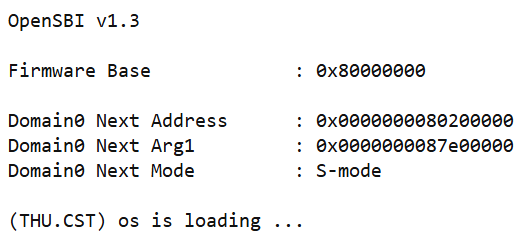
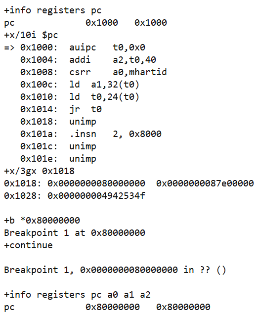
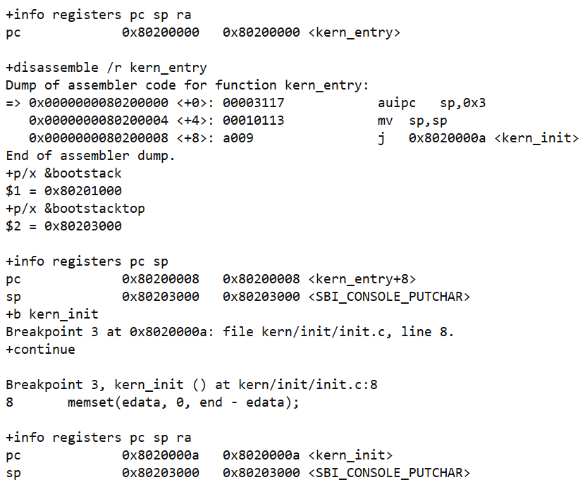

# 操作系统实验报告

## 实验基本信息

| 项目 | 内容 |
| --- | --- |
| **实验名称** | Lab1：最小可执行内核 |
| **小组成员** | 2413790-姜禧、2410250-张浩正 |
| **完成日期** | 2026-10-04 |

### 小组分工

两人共同完成实验操作、源码阅读和结果核对，工作量各占 50%。

| 成员 | 负责的练习/模块 |
| --- | --- |
| 2413790-姜禧 | 共同完成练习1、练习2、环境适配及启动验证，占 50%。 |
| 2410250-张浩正 | 共同完成练习1、练习2、环境适配及启动验证，占 50%。 |

实验报告的撰写、截图整理和最终检查也由两人共同完成，各占 50%。

## 一、实验目的

1. 跑通 RISC-V ucore 最小内核，理解源码编译、链接和镜像启动的关系。
2. 理解 OpenSBI、内核入口和启动栈的作用。
3. 使用 QEMU 与 GDB 验证从 CPU 复位到内核输出的完整过程。

## 二、实验环境

| 成员 | AI 编程工具 | 底层模型 | 备注 |
| --- | --- | --- | --- |
| 2413790-姜禧 | Codex；配合 VS Code 编辑、查看代码 | ChatGPT 6 | 辅助源码理解、调试和报告整理 |
| 2410250-张浩正 | Codex；配合 VS Code 编辑、查看代码 | ChatGPT 6 | 辅助源码理解、调试和报告整理 |

运行环境为 WSL2 Ubuntu 24.04，交叉编译器为 `riscv64-unknown-elf-gcc 13.2.0`，模拟器为 QEMU 8.2.2，固件为 OpenSBI 1.3，调试器为 `gdb-multiarch 15.1`。

## 三、实验整体逻辑分析

### 3.1 本章节的逻辑主线

本章围绕“让最小内核启动并输出一行文字”展开。本次没有新增内核功能，重点是理解已有代码，并通过实际运行验证启动链：

```text
源码 → 编译 → 链接为 bin/kernel → 生成 bin/ucore.img
     → QEMU 复位代码 → OpenSBI → kern_entry 设置栈
     → kern_init 初始化 → SBI 输出 → while (1)
```

### 3.2 功能的逐步实现

首先编译、链接源码，得到可加载的镜像；随后由 QEMU 执行复位代码，跳入 OpenSBI；固件再把控制权交给内核。内核入口必须先准备栈，C 函数才能保存寄存器和调用其他函数。最后执行初始化、输出启动文字并进入循环。这一顺序体现了内核运行所需环境的逐步建立。

## 四、实验内容与实现

### 功能模块：构建、启动与控制台输出

**负责人：** 2413790-姜禧、2410250-张浩正（共同完成）。

#### 模块功能描述

**需要实现/修改的函数：** 无。本次只阅读并验证已有函数，未修改 `kern/`、`libs/`、`tools/` 中的源码。

| 核心模块或函数 | 作用及相互关系 |
| --- | --- |
| `Makefile` | 编译源码并调用链接器，生成带符号的 `bin/kernel`，再用 objcopy 生成裸镜像 `bin/ucore.img`。前者供 GDB 使用，后者供 QEMU 加载。 |
| `tools/kernel.ld` | 用 `ENTRY(kern_entry)` 指定入口，以 `0x80200000` 为链接起点，安排代码和数据的位置。 |
| `kern/init/entry.S` | 预留启动栈，设置 `sp`，跳转到 `kern_init`。 |
| `kern/init/init.c` 的 `kern_init` | 执行 `memset(edata, 0, end-edata)`，调用 `cprintf` 输出，最后进入 `while (1)`。 |
| `kern/libs/stdio.c` | `cprintf → vcprintf → vprintfmt` 格式化字符串，再经 `cputch` 逐字符输出。 |
| `kern/driver/console.c` 的 `cons_putc` | 将字符交给 `sbi_console_putchar`。 |
| `libs/sbi.c` 的 `sbi_call` | 将服务号和参数放入寄存器，执行 `ecall`，由 OpenSBI 完成控制台输出。 |

链接脚本中的 `.text` 存指令，`.rodata` 存常量，`.data/.sdata` 存可写数据，`.bss` 对应未初始化或零初始化的静态数据。`etext`、`edata`、`end` 分别表示相应段的结束边界。本次 `edata=end=0x80203008`，实际清零长度为 0；启动栈位于 `.data`。

#### 最终提示词

本次没有新增代码实现，不填写代码生成功能的提示词。AI 主要用于辅助理解源码、适配运行环境和整理真实调试结果。

#### 实现迭代过程

本次未进行内核代码迭代，仅做了 Makefile 环境适配。原来的 `-device loader,file=...,addr=0x80200000` 在本环境中使 OpenSBI 的下一阶段地址为 0；把 `qemu/debug` 改为 `-kernel $(UCOREIMG)` 后，地址变为 `0x80200000`，并成功输出启动文字。由于本机没有 `riscv64-unknown-elf-gdb`，将调试命令改为 `gdb-multiarch`，仍保留 `-s -S`。修改前后结果均保存在原始日志中。

### 练习1：程序入口

**负责人：** 2413790-姜禧、2410250-张浩正（共同完成）。

**`la sp, bootstacktop`：** `sp` 是栈指针寄存器 `x2`。`bootstack` 为预留栈空间的起点，`bootstacktop` 为结束位置。本项目 `PGSHIFT=12`，每页 4096 字节，`KSTACKSIZE=8192` 字节，实际栈区间为 `[0x80201000, 0x80203000)`。栈向低地址增长，因此空栈从高地址端开始。该指令将栈顶地址写入 `sp`，为 C 函数保存返回地址、寄存器和局部数据准备空间。

本次入口反汇编为：

```text
0x80200000: auipc sp,0x3
0x80200004: mv    sp,sp
0x80200008: j     0x8020000a <kern_init>
```

前两条对应伪指令 `la`，得到 `sp=0x80203000`。其中 `mv sp,sp` 是 `addi sp,sp,0` 的别名，本次低位修正量恰好为 0。C 函数随后通过 `addi sp,sp,-16` 分配栈帧，说明进入 C 代码前确实需要设置栈。

**`tail kern_init`：** 将控制权交给 `kern_init`，本次链接后对应上面的 `j`。普通 `call` 会把返回地址写入 `ra`，而这次尾调用不建立返回到 `kern_entry` 的新返回地址。`kern_init` 声明为 `noreturn`，打印后进入 `while (1)`，因此不需要返回入口汇编。

### 练习2：使用 GDB 验证启动流程

**负责人：** 2413790-姜禧、2410250-张浩正（共同完成）。

运行 `make debug`，利用 `-S` 让 CPU 从启动时暂停，再用 gdb-multiarch 执行：

```gdb
file bin/kernel
set architecture riscv:rv64
set pagination off
target remote localhost:1234
info registers pc
x/10i $pc
```

首次连接时实际 `PC=0x1000`。最初的指令取得复位代码基址，设置启动信息地址，读取 HART ID，装入设备树地址和固件入口，最后通过 `jr t0` 跳转。单步到 `0x1014` 时，`t0=0x80000000`。`0x1018` 之后的 `unimp` 等显示是把启动数据按指令解码，并不表示 CPU 执行了这些内容。

随后依次使用 `b *0x80000000`、`b *0x80200000`、`b kern_init` 设置断点，每次 `continue` 后查看 PC、栈指针与反汇编，验证结果见下一节。普通断点均可工作。

GDB 将 `sp=0x80203000` 注释为 `<SBI_CONSOLE_PUTCHAR>`，是因为该变量与 `bootstacktop` 恰好同址；栈从边界向低地址增长，并不表示栈设置错误。

## 五、测试与验证

`make -B` 重新编译成功，普通启动和 GDB 调试均成功。实际观察到：

| 验证项 | 实际结果 |
| --- | --- |
| 普通启动 | `Domain0 Next Address=0x80200000`，输出 `(THU.CST) os is loading ...`。 |
| 复位入口 | `PC=0x1000`。 |
| OpenSBI 入口 | 断点停在 `0x80000000`，与 Firmware Base 一致。 |
| 内核汇编入口 | `PC=0x80200000 <kern_entry>`，设置栈后 `sp=0x80203000`。 |
| C 函数入口 | `PC=0x8020000a <kern_init>`，入口处 `sp=0x80203000`。 |
| 输出后的循环 | `PC=0x8020003a`，`sp=0x80202ff0`，当前指令跳回自身。 |

内核最后为无限循环，普通启动由 timeout 结束等待，不视为启动错误。调试完成后已退出 GDB、关闭 QEMU 并检查端口释放。当前工程缺少 Makefile 中引用的 `tools/grade.sh`，本次未执行 `make grade`，不填写不存在的评分结果。

**测试截图：** 以下只保留真实运行日志的关键片段。







以上截图节选自本次实际运行的启动与调试日志。

## 六、实验总结与收获

### 对操作系统的理解

| 实验知识点 | 对应原理及联系、区别 |
| --- | --- |
| 复位入口与 OpenSBI | 对应系统引导：固件先准备环境，再交给内核；固件不是 ucore，`0x1000` 也不是所有 RISC-V 机器统一的复位地址。 |
| ELF、裸镜像与链接脚本 | 对应程序装载和内存布局：链接地址要与加载方式配合；ELF 含符号等元数据，裸镜像不含这些结构。 |
| 内核栈与调用约定 | 对应函数调用和现场保存：C 函数依靠栈运行；本实验只有启动栈，尚无多个进程各自的内核栈。 |
| S-mode、SBI 与 ecall | 对应特权级和受控服务调用：内核请求固件服务，与用户程序向内核发起系统调用不同。 |
| 断点与单步 | 用机器状态验证执行顺序，是观察系统运行的调试手段，不是内核本身的功能。 |

本实验还未涉及进程与线程、调度、页表与虚拟内存管理、用户程序与系统调用、完整中断异常处理、文件系统和同步互斥。它们都需要建立在本次完成的启动基础之上。

### AI 协作开发的经验

我们主要使用 VS Code 查看代码，用 Codex 辅助分析和整理。AI 给出的解释需要回到本项目源码和实际日志中核对，例如 `la` 的展开形式、栈地址和 BSS 长度都应以当前编译结果为准，不能直接照搬旧实验文档。通过共同调试，我们更清楚地理解了从复位、固件到内核 C 函数的控制权转移。
